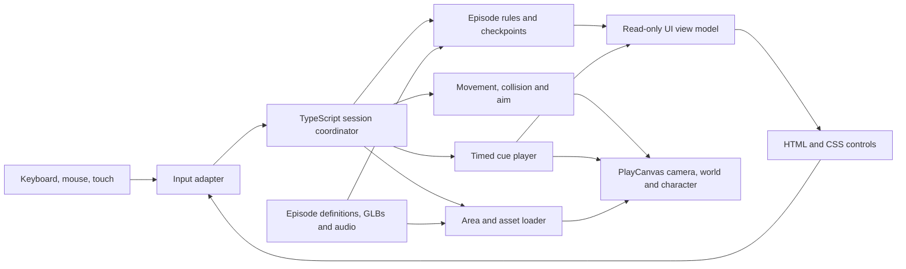
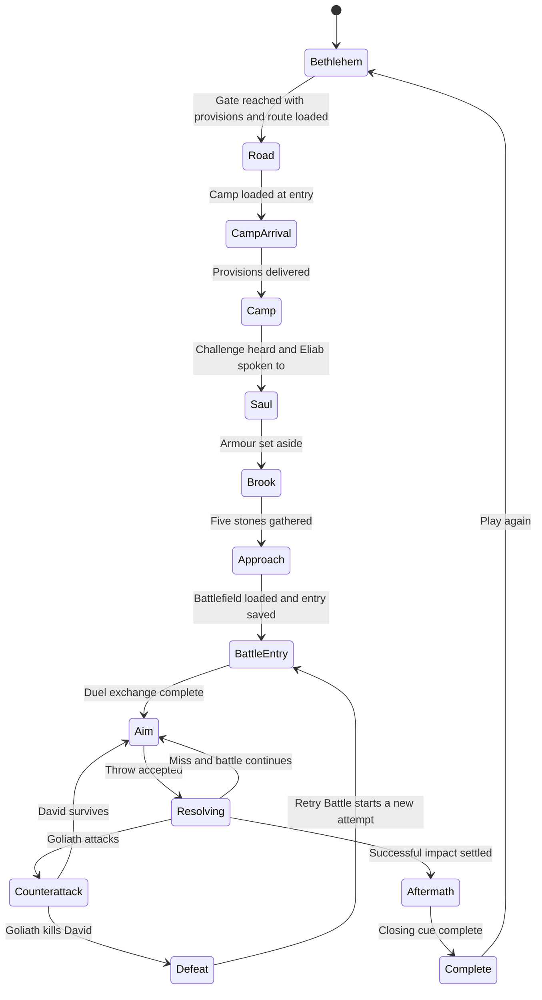

# PlayCanvas game architecture

Use a **PlayCanvas + TypeScript + Vite** browser app in `apps/playcanvas/`. PlayCanvas renders WebGL 2 and plays GLB assets. TypeScript owns game rules and the session. HTML and CSS own objectives, subtitles, pause and responsive controls. This document describes the game runtime. The production blueprint specifies the account shell, versioned assets and server-confirmed saves that surround it. [Production blueprint](../implementation/playcanvas-production-blueprint.md) · [Technical implementation plan](../implementation/playcanvas-implementation-plan.md)



## Ownership and contracts

| Module | Owns | Boundary |
| --- | --- | --- |
| **App and session** | Boot, entry, one active run, pause, retry, transitions and teardown | Routes typed player intents, updates the active mode and publishes a read-only view for the UI. A restart creates a new run and cancels outstanding work from the previous run. |
| **Episode rules** | Objective, accepted events, preparation flags, committed outcome and checkpoints | Pure TypeScript. Accepts a typed event only when its prerequisites are satisfied. Returns the next state and requested effects. Scenes, animation callbacks and DOM buttons send requests through the session. |
| **Player and camera** | Input normalization, acceleration, collision, movement-driven animation, follow camera and aiming | Use the current mode to select an input owner. Use shared static collision queries for movement, camera clearance and interaction visibility. Character pose follows actual motion. |
| **Cue player** | Camera beats, actor actions, subtitles and audio on one game clock | Emits one completion or explicit skip event for a cue instance. Pausing freezes its clock. A dialogue replay is presentation-only. Cues receive stable IDs and use validated shot, speaker and clip references. |
| **World and assets** | Area root, entry anchors, colliders, interaction targets and loaded resources | Prepare the destination before changing objective or spawn. If loading fails, show Retry and preserve the last valid state. Release the previous area's resources after a successful handoff. |
| **Browser shell** | Readable feedback, focus, pointer capture and responsive layout | Dispatches the same named actions for keyboard and touch. Displays UI at CSS size while the render buffer is capped. Clears held input on blur, cancellation, rotation and mode changes. |

Start with ordinary TypeScript modules and direct calls between their owners. Keep engine objects out of the episode rules so that tests can step events without a renderer.

## Progression and recovery



- **Separate story from control.** Keep episode progress and control mode separate. Modes cover exploration, cue playback, aim, resolution, pause and loading. Pause suspends the previous mode. Taking the bundle only advances the story when the pickup completes. The gate remains an explicit interaction after pickup.
- **Commit events once.** Give each attempt, cue, throw and attack a token. Apply each sling result and resolved Goliath attack once. Only a lethal Goliath attack can end the attempt in defeat. Discard callbacks from a cancelled cue, area load or older attempt.
- **Restore complete checkpoints.** Capture a valid area and spawn, objective, completed events, equipment or item flags and the entry mode. Use safe checkpoints at home, camp arrival, after Saul and at the battlefield entrance. **Retry Battle** starts a new attempt from the battlefield entrance, clears pending combat actions and preserves preparation. The production server confirms saves and restores the last confirmed state on reload. Restart and replay preserve prior outcomes. [Save and recovery contract](../implementation/playcanvas-production-blueprint.md#api-saving-and-recovery)
- **Validate content.** Define each objective's prerequisites and accepted event, area asset IDs and entry anchors, and cue beat times with optional camera, actor and subtitle data. Check references and time order before mounting an area. Treat dialogue and timing as editable content. Keep the Blender sources and reproducible GLB exports linked to the runtime assets.

For example, `brook.gather` requires `saul.preparationComplete` and a reachable `brook.stones` target. The interaction starts the gather cue. Its completion commits `stones.ready` once and points the player toward Elah. The area definition supplies the target's location, while the cue definition supplies the actor clip and timing. The rules validate progression independently of those presentation details.

## Proposed package layout

```text
apps/playcanvas/
  index.html, package.json, vite.config.ts
  src/
    app/          Bootstrap, session and browser shell
    gameplay/     Input, player, camera, collision and aiming
    story/        Episode rules, checkpoints and cue playback
    world/        Area mounting and asset loading
    content/      Episode, area and cue definitions
    assets/       Versioned runtime models and audio
  tests/          State contracts and browser journey checks
```

Verify pure rules for invalid order, duplicate actions, interrupted pickups, stale callbacks and checkpoint restore. Use the built app for movement, camera, keyboard and touch, transitions, muted subtitles, pause and retry. Profile startup, frame pacing and asset residency on the benchmark laptop. Record portrait and landscape results and label physical-device evidence separately. [Foundation verification](../implementation/playcanvas-implementation-plan.md#foundation-verification)

[Episode design](../story/david-and-goliath-episode-design.md) · [Production phases](../implementation/playcanvas-production-blueprint.md)
