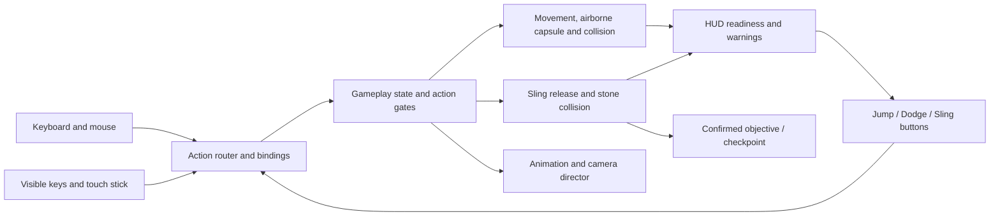

# David's player controls

16 November 2026 · [Implementation plan](player-controls-plan.md) · [Interactive control preview](http://127.0.0.1:4195/) · [Automatic opening](http://127.0.0.1:4194/episode.html)

## Decisions and current evidence

**Current integration, 16 November:** Space jumps, Shift dodges, F throws and **Q performs Jump Shot** in Chapter 5. The owner's subsequent request adds a wider, ranged spear encounter, route arrows and automatic stones. [Current implementation and browser evidence](../implementation/encounter-and-route-polish.md). CTRL-04/05 remain the historical jump/collision baselines; the earlier close-thrust proposal below is superseded for the live Chapter 5 encounter.

The owner requires an automatic flock/messenger opening, visible movement controls, jumping, dodging and a cinematic sling action. **Goliath keeps his spear**, following the owner's latest correction. The courtyard conversation and provisions pickup remain player-triggered after the opening.

The automatic opening, [CTRL-03 shared movement/actions](../implementation/ctrl03-shared-controls.md), CTRL-04 jump and CTRL-05 physical collision are integrated. Port 4199 is the current ranged/jump-shot review; earlier ports and the separate design simulation remain historical references. The owner subsequently authorised visible spear flight and a cinematic jump-and-sling action, so these are now implemented rather than future proposals.

| Existing foundation | Evidence / implication |
| --- | --- |
| WASD/arrows, mouse look/aim, touch stick and simultaneous action touch | [movement-input.ts](../../apps/playcanvas/src/gameplay/movement-input.ts). Reuse its pointer ownership and cancellation behaviour. |
| Directional animated dodge | [movement-area.ts](../../apps/playcanvas/src/world/movement-area.ts). Current dash, cooldown and left/right clips can be retained. |
| Three evasions before the sling | [elah-battle.ts](../../apps/playcanvas/src/gameplay/elah-battle.ts). Preserve this earned progression unless the owner changes it. |
| Real jump movement | Shared gravity/ground/overhead motor and three Blender clips on the retained rig; Jump Shot coordinates these with the sling layer and a real airborne release. |
| Physical spear hit test | Swept moving shaft/head versus the actual airborne capsule. Live Chapter 5 uses a ballistic throw at approximately 9.5 m; the earlier melee fixture remains isolated. |
| Forehead targeting, stone trajectory, miss, refill, lethal defeat and Retry Battle | Retain and extend the working battle. A cinematic camera must not manufacture the winning hit or commit the objective early. |

## Research translated into this design

- **Map actions and allow rebinding.** Microsoft recommends action remapping, including replacing combinations with a single action where appropriate. This supports a named Jump Shot action instead of requiring a fast Jump+Throw chord. [Xbox Accessibility Guideline 107](https://learn.microsoft.com/en-us/xbox/accessibility/xbox-accessibility-guidelines/107).
- **Put frequent actions in thumb reach.** Microsoft's touch-design guidance recommends a minimal, scene-dependent layout and reachable primary actions. Apply those principles to native HTML/Pointer Events on PlayCanvas: movement left, combat right, a clear centre. [Microsoft touch-control design guide](https://learn.microsoft.com/en-us/gaming/gdk/docs/features/common/game-streaming/building-touch-layouts/game-streaming-tak-designers-guide?view=gdk-2604).
- **Hide gameplay controls in cinematics.** Keep pause and sound available; reveal movement when the scene returns control. The same Microsoft guide supports a minimal cinematic layout.
- **Use generous targets.** W3C's enhanced target-size guidance uses 44 × 44 CSS px. Our proposal uses 48 px direction keys, 56 px secondary actions and 64 px Sling; compact direction keys may reduce to 44 px. This is a design reference, not a claim of complete WCAG conformance. [W3C target-size guidance](https://www.w3.org/WAI/WCAG22/Understanding/target-size-enhanced.html).

## Proposed control map

Movement, aiming, interaction, ordinary Sling, Pause, Space Jump, Shift Dodge and Q Jump Shot are live. Land before ordinary throwing or interacting. Jump Shot coordinates its own leap and release. Automatic stone collection uses no interaction action.

| Action | Desktop default | On-screen / touch |
| --- | --- | --- |
| Move | WASD or arrow keys | Visible four-key console on desktop; left thumb stick on touch, with an optional arrow-button layout. Diagonals normalised. |
| Look / aim | Mouse; retain IJKL keyboard aim | Drag the unobstructed right-side game area. Keep this contact independent of the movement stick. |
| Interact | E | One contextual button: Speak, Take, Inspect or Continue. Only show a valid nearby action. |
| Jump | Space | Jump button. Grounded-only, one request per press; holding does not repeat. |
| Dodge | Shift (either Shift key) | Dodge button. Hold a movement direction to choose a side; without one, use the warning's indicated safe side. |
| Sling | Click or F | Large Sling button. Aiming and throwing remain separate on touch. Misses remain recoverable. |
| Jump Shot | Q | Labelled button after three evasions, with a stone and grounded recovery. Aim manually; one action queues the leap and release. Incorrect aim can miss. |
| Pause / resume | Escape | Persistent Pause button; input clears on pause. |

Jump Shot is an alternative to ordinary Sling, not a new mandatory completion gate. Advanced players can eventually use Jump then Sling manually. The named single action keeps the cinematic move available without requiring that combination.

## Screen arrangement

| State | Visible controls and feedback |
| --- | --- |
| Automatic flock/messenger and father–son exchange | Captions, Pause and sound. Movement and combat controls hidden. No Tend prompt. |
| Player walks to Jesse / explores | Lower-left movement console; lower-right contextual interaction; world destination/distance; brief move instruction when control returns. |
| Spear defence | Movement left; Jump and Dodge right. Sling shows its lock reason until the three evasions are earned. Incoming attack direction uses text, a lane/arrow and animation, with sound as an additional cue. |
| Sling opportunity | Sling is primary. Jump and Dodge remain available. Jump Shot appears with a visible forehead-aim requirement; a neutral target ring becomes a labelled ready state when lined up. |
| Defeat / retry | Clear result and Retry Battle. Clear all input/queued actions before returning to the existing battle checkpoint. |

Keep the aiming target and upper bodies readable. Use a full game viewport with compact HUD instead of spending scarce landscape height on large page headers/footers. Portrait uses a vertical camera composition; landscape spreads the two clusters apart. Do not shrink touch hitboxes to make a screenshot fit. At 320 px the default thumb stick preserves more scene space than the optional four-key console.

The WASD console should be **functional**, with press-and-hold pointer buttons and matching physical-key illumination. It is not merely an instruction image. Releasing a virtual W must not cancel a simultaneously held physical W. The touch stick remains the preferred default for continuous movement on phones; both use the same movement action.

## Jump, spear and cinematic rules

1. **Real airborne motion.** Starting tuning recommendation: approximately 0.8 m height and 0.8 s flight, inherited horizontal movement and a grounded/airborne/landing state. Use in-place animation; physics supplies vertical root motion once. Author takeoff, airborne, landing and jump-sling performances on the existing teenage David rig. Tune through play, not by treating these numbers as accepted results.
2. **Physical defence.** Jump does not grant invulnerability. The vertical capsule and swept spear collision decide clearance. A high thrust can still hit an airborne David; directional Dodge remains the reliable defence. The warning must never tell the player that jumping automatically makes them safe.
3. **Weapon scope.** Keep the current spear thrusts for the first controller integration. A ranged spear throw needs its own release, trajectory, timing and impact work; it is a separate proposed extension, not something already implemented by retaining the weapon. No arrows are planned.
4. **One authored jump shot.** On Q/tap, validate current phase, aim, stone count, grounded state and cooldown. Queue one leap and a release near the apex. Spawn the stone from the animated hand at its actual world height. Consume one stone once. Preserve ordinary shot/miss/refill behaviour.
5. **Camera follows the result.** Use a short shoulder/tracking move that keeps the threat and David visible. Reserve the close impact/fall shot for an actual verified forehead hit. Never teleport David, grant automatic victory or let a dramatic cut hide an unresolved incoming strike. Recommend a reduced-motion option without shake/roll.
6. **Recovery and cancellation.** Reject conflicting jump/dodge/throw states; consider a small landing input buffer. Drop queued actions on pause, blur, hidden tab, pointer cancellation, chapter transition, defeat and retry. Return control explicitly when authored performance ends.

## Engineering architecture

Use one action router, not synthetic keyboard events emitted by buttons. Keep held sources separate by device/pointer ID; combine movement at read time. Edge-trigger Jump/Dodge/Throw/Jump Shot, and clear them at the same state boundaries as movement. The HUD reads the same `canJump/canDodge/canThrow/canJumpShot` gates as gameplay.

CTRL-04 switches the input map, help, prompts and tests together to Space Jump / Shift Dodge. Control preferences remain separate from confirmed episode progress. Browser shortcuts and text/select fields remain usable.

## Implementation order after this design review

| ID | Goal and dependencies | Output / completion evidence | Effort assumption |
| --- | --- | --- | --- |
| CTRL-01 | Automatic intro; existing scene/voice clock | No Tend input; tending and messenger overlap; control then works to the courtyard. Implemented and browser-verified separately. | This pass |
| CTRL-02 | Research, control map and design preview | Desktop, portrait and landscape review of movement/aim/actions, pause and cinematic mask. Simulated mechanics labelled. | This pass |
| CTRL-03 | Action router and actual console; layout approved | Implemented and browser-verified: physical/virtual ownership, two-thumb input, bindings and focus/cancel checks in actual exploration, practice and battle. [Handover](../implementation/ctrl03-shared-controls.md). | Original estimate: 6–10 h; actual effort not tracked |
| CTRL-04 | Jump motion and authored clips; CTRL-03 | Implemented and browser-verified: takeoff/flight/landing, walls/roof clearance, actual rig deformation and follow cameras. [Handover](../implementation/ctrl04-jump-movement.md). | Original estimate: 12–20 h; actual effort not tracked |
| CTRL-05 | Spear/capsule collision; CTRL-04 | Implemented and browser-verified: actual shaft/head sweep against airborne capsule, timed low clearance, higher airborne hits, pause and fair retry in portrait/landscape/desktop. [Handover](../implementation/ctrl05-spear-collision.md). | Original estimate: 6–10 h; actual effort not tracked |
| CTRL-06 | Jump Shot and shot camera; CTRL-04/05 | Implemented and browser-verified as part of the [ranged encounter request](../implementation/encounter-and-route-polish.md): one queued airborne release/stone, true hit/miss, pause and camera/control return on desktop/portrait/landscape. | Original estimate: 10–16 h; actual effort not tracked |
| CTRL-07 | Episode integration and first-time play | Engineering regression verified: fresh Chapters 1-6 on desktop/portrait/landscape, pause/restart/checkpoints, defeat/retry, misses/hits, completion/replay and CPU stress/live rotation. [Handover](../implementation/ctrl07-episode-integration.md). Unaided first-time comprehension and creative acceptance remain pending; first-Elah transition hitch documented. | Original estimate: 6-10 h; actual effort not tracked |

These are engineering/animation effort ranges for the existing project and rig, not a guaranteed delivery date. Art revisions and review can add work. Keep these changes sequential through the shared controller/animation layer; caption/HUD styling and test preparation can proceed independently against the agreed action contract.

## Owner approval and remaining decisions

The owner approved the layout and authorised CTRL-03/04/05, then requested wider spacing, visible spear flight, a cinematic jump shot, route arrows and automatic stones. Desktop direction keys, the mobile thumb-stick default, optional keys and labels remain. The [current handover](../implementation/encounter-and-route-polish.md) supersedes the earlier live melee presentation while retaining physical collision and saved progression. Animation quality, battle balance and creative acceptance still require owner review; technical browser verification is separate.

The owner has now requested ranged spear flight; it is implemented in Chapter 5. No arrows are planned. The historical design's melee timing recommendations are not the current ranged attack contract.

The preview demonstrates placement and input/readiness feedback. It does not establish animation quality, battle balance, player enjoyment or physical-device performance. Those are integration exit gates.
