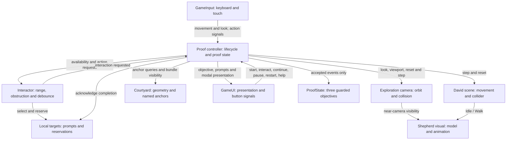

# B01 scene ownership and component contracts (updated for B05)

29 October 2026. This describes the implemented courtyard foundation. The [plan](b01-foundation-plan.md) bounds this work; [verification](b01-foundation-2026-10-29.md) records execution. Final episode systems remain future work. B02 adds the [camera/movement contract and evidence](b02-movement-camera-2026-10-29.md) below; the original B01 verification is historical.

B03 update, 9 November: [village_proof.tscn](../../scenes/proof/village_proof.tscn) now composes the same components with [village.tscn](../../scenes/world/village.tscn). Controller exports `world_path`, `location_name` and `build_id` select the world and presentation identity. Both worlds implement `spawn_position()`, `target_position(id)` and `show_provisions(bool)`. `GameUI.configure_location(name)` changes labels only; story state remains in the proof controller. The original courtyard stays available for regression. See [B03 implementation](b03-village-2026-11-09.md) for module contracts and evidence.

B04 update, 9 November: [interaction contracts and evidence](b04-interaction-2026-11-09.md) add instanced local targets and an Interactor to both proof worlds. `interaction_targets()` supplies each world’s candidate list. The controller sets availability, receives requests and acknowledges completion; targets/detection contain no narrative rules.

B05 update, 9 November: [responsive UI contracts and evidence](b05-responsive-ui-2026-11-09.md) add Controls signals (`help_requested`, `help_closed`) and `show_help(touch, current_objective)`. The controller owns help lifecycle/input suspension and preserves story state; the UI owns viewport sizing, scrolling and focus. The HTML shell owns loading and reload recovery.

## Composition and ownership

| Scene / script | Owns | Public contract | Deliberately outside its responsibility |
|---|---|---|---|
| [courtyard_proof.tscn](../../scenes/proof/courtyard_proof.tscn) / [controller](../../scripts/proof/courtyard_proof.gd) | Component instances, one ProofState per visit, pause/dialogue/quality/audio lifecycle, story-driven target availability/acknowledgement and camera-rig wiring | Wire local node references and signals once; mutate progression only through state acceptance; reset state and presentation together | Full episode narrative engine, final dialogue approval, cloud services |
| [david.tscn](../../scenes/player/david.tscn) / [player_controller.gd](../../scripts/player/player_controller.gd) | CharacterBody3D, capsule collision, velocity, facing and visual child | `step(delta, movement, yaw, enabled)`; `stop()` cancels velocity immediately; `reset_at(world_position)` clears velocity and returns to Idle | Story progression, input device detection, dialogue |
| [exploration_camera.tscn](../../scenes/player/exploration_camera.tscn) / [camera script](../../scripts/player/exploration_camera.gd) | Orbit angles, camera volume collision, boom extension, near-player visibility and viewport framing | `apply_look(delta)`, `set_viewport_size(view)`, `step(delta, player)`, `reset()` and read-only `evidence()` | Story state, input ownership, player movement |
| [shepherd.tscn](../../scenes/characters/shepherd.tscn) / [character_visual.gd](../../scripts/characters/character_visual.gd) | GLB instance, skeleton, AnimationPlayer and named clip lookup | `play("Idle"/"Walk"/"Wave")`; read-only `animation_evidence()` | Movement, objective completion or final character portrayal |
| [game_input.tscn](../../scenes/player/game_input.tscn) / [game_input.gd](../../scripts/player/game_input.gd) | Held physical key events, touch IDs, movement/look accumulation | `active`, `get_movement()`, `take_look()`, `clear()`; `interact_requested` and `pause_requested` signals | Whether an interaction is allowed or what state it changes |
| [courtyard.tscn](../../scenes/world/courtyard.tscn) / [courtyard.gd](../../scripts/world/courtyard.gd) | Existing geometry/materials/lights/collision and named world-space anchors | `spawn_position()`; `target_position(id)`; `show_provisions(bool)` | Deciding whether provisions have been collected |
| [game_ui.tscn](../../scenes/ui/game_ui.tscn) / [game_ui.gd](../../scripts/ui/game_ui.gd) | Current HUD/buttons/modal layout and display mode | `show_welcome`, `show_game`, `show_card`; setters for objective/progress/context/toast/sound/quality/diagnostics; request signals | Owning story progress or directly moving David |
| [objective_marker.tscn](../../scenes/ui/objective_marker.tscn) and [provisions.tscn](../../scenes/world/provisions.tscn) | Reusable presentation nodes | Position/visibility/label are controlled by the owner | Hidden event triggers or progression mutations |
| [Interactor](../../scenes/interaction/interactor.tscn) and [Interactable](../../scenes/interaction/interactable.tscn) | Local target discovery/selection, range/occlusion, debounce, prompt metadata and reservation/consumption | See [B04 contracts](b04-interaction-2026-11-09.md#component-contracts); every dispatched action must be acknowledged | Deciding story eligibility or mutating objectives |
| [proof_state.gd](../../scripts/proof/proof_state.gd) | JESSE → PROVISIONS → GATE → COMPLETE | `accept(event)` guards order and duplicates; `reset`, `objective`, `target_id` | Full-episode checkpoints, encounter outcomes or approved final script |

The player/visual scripts moved with their `.uid` sidecars. The imported GLBs and editable Blender sources are unchanged. The world generator moved out of the controller; its `@tool` preview builds non-owned geometry in the editor without serialising duplicate generated meshes. Anchors and component instances are saved in `.tscn` files. UI child construction remains scripted. B05 retains the existing presentation API and adds Controls help signals/methods, responsive containers and visible keyboard focus.

## Input actions and lifecycle

| Godot Input Map action | Keyboard bindings | Touch / UI equivalent |
|---|---|---|
| `move_forward` | Physical W / Up | Left movement region, upward |
| `move_back` | Physical S / Down | Left movement region, downward |
| `move_left` | Physical A / Left | Left movement region, left |
| `move_right` | Physical D / Right | Left movement region, right |
| `interact` | Physical E | Context or dialogue-continue button |
| `pause_game` | Escape | Pause / continue button |

Mouse drag and a separately tracked right-side touch provide look deltas. `get_movement()` normalises combined keyboard/touch movement. Keyboard events match project Input Map bindings; remapping a binding does not require player/controller edits. One physical key release must not clear a different held binding for the same action.

The input adapter emits action requests even when movement is disabled, so dialogue/paused UI remains usable; the courtyard controller applies mode/availability guards. The controller clears held input at entry, dialogue/help boundaries, pause/resume, restart, resize, window exit and focus loss. Deactivating the adapter also clears ownership. Modal/resize/focus cancellation immediately stops player velocity. B02 moves camera yaw/pitch, framing and collision into its rig; the controller forwards look and steps the rig after player movement/recovery. UI touches use Godot's GUI adaptation; emulated mouse events never also become world-look gestures. Cancelled touches cannot reacquire a control.

World anchors and player resets use world coordinates. Recovery bounds are measured relative to the current world, so translating the whole courtyard does not trigger false out-of-bounds recovery. This supports placement, not an untested arbitrary world-scale/rotation guarantee.

## Integration rules and verification

- Reuse these scenes by instancing them. Mutable state, skeletons and animation playback belong to each instance; immutable mesh/material resources may be shared. There is no global event bus or autoload state singleton.
- Keep the current proof controller and state isolated. C01/C02 will introduce only the approved episode state/dialogue data; do not repurpose the three proof stages as a claim that those tasks are done.
- B04 supplies reusable interaction targets/detection; narrative dispatch and target availability stay in the proof controller. Target-phone usability/G2 acceptance remains open. B02 now verifies representative slopes/camera edge cases and input lifecycle locally; physical touch validation is still open. B03 supplies the representative village locally; art review and physical-device/G2 acceptance remain open.
- Run `.\tools\check-foundation.ps1` for a fresh copied-project import, all six engine suites, startup, release export and actual PCK dependency/exclusion check. It does not delete the working project's cache.
- Run `.\tools\export-proof.ps1`, serve with `.\tools\serve-proof.py`, and run the browser journey checks against that exported build. Export success alone does not verify controls.
- Keep build identity and test evidence together. A04/A05 records remain historical; a changed source tree must receive a new verification record.

## Proposed version-control conventions

The repository is still on unborn `master`; no commit, push, branch rename or deployment is performed here. When Git changes are explicitly authorised, include source scenes/scripts, `.uid`/`.import` sidecars, original asset sources/provenance and documentation. Exclude `.godot/`, generated `build/`, secrets and Blender backup files under the existing ignore rules. Use a focused `codex/` branch for future authorised branch work and keep shared scene/project changes in one coherent review. No CI or remote workflow is claimed merely because these conventions are documented.
