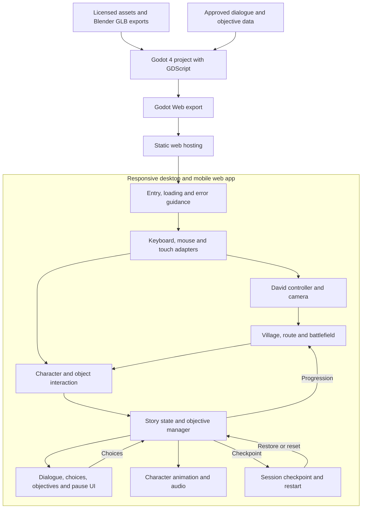

# David and Goliath project implementation plan

The owner selected PlayCanvas, TypeScript and Vite after the matched browser comparison. The [PlayCanvas implementation plan](playcanvas-implementation-plan.md) now guides the browser foundation and village port. The record below provides the original Godot development history and product baseline.

Prepared on 29 October 2026, before implementation of the remaining development tasks. This plan translates the existing A01–F03 schedule into an execution sequence. It does not replace the product scope, silently approve open decisions or mark planned work complete.

Current execution: A01 revalidated, A02 product choices recorded, and [A03 toolchain setup](a03-toolchain-setup-2026-10-29.md) complete. The [A05/A04 proof](a05-a04-proof-2026-10-29.md) now verifies original assets and local browser interaction. A05 technical acceptance is met; A04 remains partial pending physical devices and the G1 decision. The subsequent [B01 plan](b01-foundation-plan.md), [contracts](b01-component-contracts.md) and [verification](b01-foundation-2026-10-29.md) prepare reusable components locally without expanding content. A06 has a prepared device/session register; actual bookings remain open. The owner subsequently authorised [B02 movement/camera hardening](b02-movement-camera-2026-10-29.md) within the existing courtyard. B02 remains partial pending physical-device/G1 acceptance. The owner subsequently authorised B03 on 9 November: the [prior plan](b03-village-plan.md) and [implementation/evidence](b03-village-2026-11-09.md) record a bounded representative village. B03 remains partial pending art review and physical-device/G2 acceptance; G1 is still open. This explicit task authorisation is not approval of the remaining content or release gates.

B04 update, 9 November: the [prior plan](b04-interaction-plan.md) and [implementation/evidence](b04-interaction-2026-11-09.md) record reusable targets and detection, once-only acknowledgement and contextual prompts in both worlds. B04 remains partial pending physical-phone usability/G2. B05 followed with [responsive UI and recovery](b05-responsive-ui-2026-11-09.md), under its [prior plan](b05-responsive-ui-plan.md). Local engine/export checks are recorded as EV17; physical-phone usability/G2 remains open. B06 now has a [frozen candidate and local verification](b06-vertical-slice-2026-11-09.md) under its [prior plan](b06-vertical-slice-plan.md). Physical-device/player observations and G2 remain pending; the full-episode date still needs reforecasting.

## Planning baseline and authority

The owner revised mobile acceptance to responsive browser testing in portrait and landscape. Physical handset sessions are optional. Before full story expansion, review the village as an Iron Age setting and observe an unaided first playthrough. [Village story presentation plan](village-story-presentation-plan.md)

Quality planning update, 9 November: the [animation quality improvement plan](animation-quality-improvement-plan.md) translates the runtime review into Q01–Q06 work on the existing village, before broader story production. It proposes a ten-working-day quality sample with an 8–15 person-day range, subject to asset and device access. This is not a new full-episode commitment or completed implementation; original task statuses and G1/G2 remain unchanged. The owner's automatic Jesse conversation direction supersedes the earlier mandatory manual-advance draft.

- [Project specification](../../Bible_Comics_Project_Specification.docx): product experience, scope and definition of done. The owner confirmed this is the intended boss-facing document.
- [Technical implementation plan](../../Bible_Comics_Technical_Implementation_Plan.docx): proposed engineering approach and technical acceptance.
- [Schedule and ownership](../roadmap/technical-task-breakdown.md#schedule-and-ownership): the canonical task IDs, effort estimates and proposed role allocations.
- [Roadmap](../roadmap/development-roadmap.md): delivery windows and dependencies.
- [Scope and acceptance](../roadmap/mvp-scope-and-acceptance.md): must-have requirements, quality gates and user-test protocol.
- [Decisions](../roadmap/risk-and-decision-register.md): unresolved product and delivery choices.
- [Gap analysis](../roadmap/requirements-gap-analysis.md): assessment evidence, including the original source fingerprints.

The owner has directed that the player acts as David, the product is a responsive desktop-and-mobile web app, and initial development should take around two weeks. Those directions are settled. Touch usability is included in the implementation baseline. U3 also approves the 10–15 minute target, fixed outcome, assisted sling aiming, non-graphic ending, illustrated 3D, both orientations, no login/cloud saves and session checkpoints. Detailed narrative, art sample, supported physical devices and numerical thresholds remain open; see the [owner decision record](a02-decision-record-2026-10-29.md).

The existing stretch target is a playable candidate on 10 November, followed by validation/fixes and the 30 November release decision. As of 29 October, nine weekdays remain through 10 November inclusive. The earlier dates are not reset or represented as completed work. Development estimates remain 23.5–41 person-days across contributors, and 29–51 for the whole plan before contingency. The confirmed team is Segun working with the assistant; earlier separate engineering/art/QA roles are estimating categories, not available staff. Original human-effort estimates are not a forecast of assistant productivity. Re-estimate after the browser proof; do not compensate for a missed gate by omitting mobile testing or story completion.

The current request authorises starting implementation after this written plan. The earlier assessment-only restriction does not prevent subsequent local development. Existing restrictions on committing/pushing, deployment and destructive Git operations remain in place. No new approval is needed merely for routine reversible implementation choices. Product decisions still require their actual decision maker; a technical prototype can proceed with clearly labelled placeholders.

## Intended MVP result

Apply the owner's U4 lightweight/lower-capacity requirement throughout A04/A05, responsive UI and profiling, using the [low-end device performance plan](low-end-device-performance-plan.md). Build economical visuals first and verify exported gameplay on weak physical devices before adding visual extras. Candidate hardware classes and a 30 FPS working goal are proposals, not completed tests or approved published minimums.

A player opens the web app, learns the controls, explores a limited village as David, interacts with characters and relevant objects, follows objectives through a connecting route to the battlefield, performs the approved dramatic encounter, reaches a clear ending and can restart. Keyboard/mouse and touch operate the same gameplay actions. Animation, sound, readable dialogue and feedback support this journey.

Build a direct-launch prototype first. The owner has excluded login/cloud saves and approved in-session checkpoints. A database and separate React/Next.js shell are not required by the baseline. Durable local resume remains deferred under DEC-07. Native mobile applications, additional episodes, multiplayer, an open world and elaborate combat remain outside this implementation baseline.

## Proposed architecture

This diagram describes the intended full-episode architecture. The isolated courtyard proof implements only a subset; it does not complete these production systems.



Use the technical plan's Compatibility renderer and single-threaded GDScript web-export approach. A03 pins Godot 4.7.2 and Blender 4.5.15 LTS with matching web templates; subsequent A04/B01 records verify local desktop/browser-emulation behavior. Physical phone compatibility remains unverified. Local HTTP testing precedes any authorised hosted deployment.

## Proposed repository organisation

Keep the Godot project at repository root. Preserve both source DOCX files and the existing documentation. Create directories only when their task needs them; do not scaffold empty systems for later features.

```text
project.godot                  Project settings and input actions
export_presets.cfg             Repeatable web-export settings
scenes/
  proof/                       Small Phase A feasibility scene
  boot/                        Entry and loading flow
  player/                      David, camera and input integration
  world/                       Village, route and battlefield
  characters/                  NPC and encounter subscenes
  interactables/               Reusable interaction targets
  ui/                          Dialogue, objective, pause and ending UI
scripts/
  player/                      Device-independent player actions
  interaction/                 Target detection and interaction dispatch
  story/                       State, objectives and dialogue handling
  services/                    Recovery and optional save adapter
data/                          Approved story and dialogue data
assets/                        Imported GLB, textures, materials and audio
source-assets/                 Editable Blender sources, excluded from game export
tests/                         Logic tests and focused engine test scenes
tools/                         Reproducible export and local verification helpers
build/web/                     Generated output, excluded from Git
docs/
  roadmap/                     Existing planning baseline
  implementation/              This plan, task evidence and technical decisions
  story/                       Proposed then approved story map and content
  assets/                      Asset register and import conventions
  testing/                     Device matrix, cases, observations and defects
```

During A04 the project contains only what the proof needs. B01 formally closes after feasibility is demonstrated; the owner's later continuation request prompted bounded extraction of the existing proof into reusable scenes while G1 remains open. This preparation does not complete B01 or expand story content. Exclude generated caches/builds, local tool binaries and source-only documents/assets from inappropriate version-control or export inclusion. Verify the exported package rather than assuming exclusion rules work.

## Component responsibilities and contracts

Define these contracts in B01 before dependent components are implemented. Names below describe behaviour; they are not promises of a particular API or class hierarchy.

| Component | Owns | Contract to verify |
|---|---|---|
| Input adapter | Movement/look vectors and interact/pause/retry actions | Keyboard/mouse and touch map to the same actions. UI touches do not leak into world interaction. Cancelled touches or lost focus clear held input. |
| Player and camera | Locomotion, collision, camera limits and safe spawn | Uses input actions without owning story state. Movement can be suspended during pause/dialogue without losing recovery state. |
| Interaction component | Available target, distance/visibility checks and prompt lifecycle | An eligible action emits a stable event once; range exit or unavailability hides the prompt. |
| Story/objective manager | Authoritative progression and prerequisite checks | Only valid transitions apply. Repeated events are idempotent; invalid events cannot unlock later stages. |
| Dialogue runner | Speaker/text/choices and content navigation | Conditions use story state; valid choice results return through the story manager. Invalid content references fail visibly during validation. |
| World and presentation | Scene transitions, actors, animation and sound | Reacts to accepted story events; animations and cinematics do not secretly own progression. |
| Recovery service | Safe checkpoint, objective/event state and full reset | Restores a valid consistent state. Restart clears completion and one-shot flags. Durable storage is conditional; in-session recovery remains usable without it. |
| Browser entry | Launch, loading progress, user gesture and recoverable errors | Works with touch and keyboard/mouse. Does not duplicate game progression or require a backend for the proof. |

Avoid a general narrative engine, content-management platform or global event framework unless a concrete first-episode requirement demands it. A small explicit state table and reusable interaction component are sufficient starting points.

## Phase A execution plan

| Task | Implementation steps | Expected output | Verification and completion |
|---|---|---|---|
| A01 Review and inspect | Recheck Git and file inventory, source fingerprints and any repository instructions. Revalidate tool discovery. Reuse the prior full source review when fingerprints match; reread changed sources. | Dated assessment record linked from this plan | Evidence distinguishes actual files/tools from proposed features; source identity and owner overrides remain recorded. |
| A02 Prepare story and delivery decisions | Draft the complete story graph, encounter options and dialogue outline. Prepare a device/support proposal, art reference, access/save recommendation and capacity assumptions. Present concrete choices to the owner. | Story proposal and updated decision register; approval records only when received | Every planned objective has an action, success condition, feedback and recovery path. An unapproved draft does not complete A02. |
| A03 Establish toolchain | Locate any existing Godot/Blender install. Otherwise use official distributions, pin versions and matching web templates, record download/version evidence and setup commands. Open a minimal project to check imports. | Toolchain manifest and setup instructions | Version commands and matching-template checks succeed; minimal project opens without import errors. Exact versions chosen during this task, not guessed here. |
| A05 Prove assets | Select one suitable environment module and animated/rigged character with clear usage rights. Record source/licence/attribution. Check Blender scale, orientation, rig and animation; export GLB. | Representative GLB assets, editable source where available and asset register | Godot imports geometry/materials/animation correctly. Browser animation evidence is collected with A04 before final A05 completion. No purchase or final art approval is assumed. |
| A04 Prove web runtime | Create one small navigable proof area with a character, contextual interaction, animation and audio cue. Add keyboard/mouse and touch input sufficient for the proof. Export and serve locally; measure load/frame behaviour and capture errors. | Repeatable export, runnable proof and device-specific results | Execute actual browser input/animation/audio/restart checks. Real-phone checks must be labelled separately from viewport emulation. Missing physical devices leave the mobile portion unverified. |
| A06 Prepare validation access | Prepare the participant/task sheet, proposed session dates and device checklist. Request device availability and tester coordination from the owner. | Device inventory and recruitment/session plan; actual bookings when confirmed | A written plan is partial work. Only confirmed device access and booked non-builder participants satisfy the original task. No invitations are sent without explicit messaging authorisation. |

**Working order:** A01 → A02 preparation and A03 technical setup → A05 representative import → A04 integrated browser proof. A06 preparation can proceed independently after A01. A05 and A04 complete together where browser animation verification is shared. This dependency order takes precedence over the numeric placement of A04 before A05 in the schedule table.

**Gate:** complete G0/G1 evidence before broad foundation/content production. If only desktop export works, record partial progress and diagnose the mobile gap. The agent can prepare test instructions and build packages, but cannot substitute simulated phones for physical-device evidence or manufacture owner approval.

## Remaining implementation sequence

Each row retains the task scope and estimates from the schedule. The table below adds the intended implementation result and handoff; detailed acceptance remains in the linked roadmap documents.

| Phase and task | Planned implementation result | Dependencies / verification |
|---|---|---|
| B01 Structure | Minimal scene tree, input actions, component contracts and export instructions | G1 and sufficient scope decisions; clean open/import/export check |
| B02 Player | Responsive third-person controller, camera, collision and touch adapters | B01; walk required routes, test simultaneous touch movement/look and recovery |
| B03 Village | Small modular representative environment with usable routes and interaction locations | Approved asset conventions; player can reach every required location |
| B04 Interactions | Reusable target detection, prompts and once-only actions | B01 contracts; range/visibility/unavailable/repeated-input checks |
| B05 Responsive UI | Entry/loading/error/help, dialogue/objectives and pause/restart UI | Input and browser proof; resize, touch reachability, safe areas and approved orientation policy |
| B06 Slice verification | Exported entry → movement → interaction → objective response | B02–B05 integrated; device checklist and first-time-user observation; G2 |
| C01 Story/objectives | Explicit guarded state graph, event IDs and objective data | Approved story map; automated allowed/forbidden/duplicate/reset checks |
| C02 Dialogue | Data-driven approved dialogue and limited choices | C01 schema; valid choices/re-entry/cancellation and mobile text layout |
| C03 Route/battlefield | Connected setting subscenes with correct collision and transition spawns | Village/modules and approved story; state-preserving transitions |
| C04 Characters | Small compatible rig/animation set for required actions | Asset proof and content/art approval; exported animation checks |
| C05 Recovery | Safe session checkpoints, retry, pause/resume and full restart | C01 state contract; missing/invalid/denied-storage fallback where relevant |
| C06 Integration | Continuous story progression to the battlefield | C01–C05; fresh/revisited/invalid-order browser journeys; G3 |
| D01 Encounter | Approved playable climax, reactions, outcome and retry | G3 and encounter decision; player action required, success emitted once |
| D02 Whole episode | Opening through encounter to ending and full replay | Encounter contract and recovery; complete fresh-session browser journey; G4 |
| D03 Presentation | Coherent materials/lighting, required animation, ambience and action cues | Approved reference and licensed content; owner review and device checks |
| D04 Performance | Measured reductions in frame/load/memory costs | Representative scenes first, final integrated build for acceptance |
| D05 Mobile hardening | Complete touch/layout/orientation/tab-resume behaviour | Full episode and approved matrix; every required action achievable on real phones |
| E01 QA/pilots | Executed full-path, recovery, input and device cases; pilot notes | Available candidate; failures and unavailable scenarios explicitly recorded |
| E02 External validation | 5–8 non-builder sessions with device/build-specific outcomes | G4 and confirmed participants; unaided completion, confusion and return-interest evidence |
| E03 Fix/retest | Reproduced critical issues closed with affected-path regression | Observed findings; no new optional features; G5 |
| F01 Freeze/regress | Immutable candidate manifest and complete regression evidence | G5; fresh playthrough/replay on the agreed matrix |
| F02 Hosting/package | Reproducible export/hosting runbook, package identity and hosted verification | Frozen candidate, chosen host and explicit deployment authorisation |
| F03 Handover/decision | Known limitations, deferred backlog, operating instructions and release recommendation | Current evidence and actual owner go/no-go; G6 |

Owner decisions, content review and physical user sessions cannot be automated into successful statuses. Preparation may proceed while these dependencies are unresolved, but completion requires the relevant evidence.

## Calendar and checkpoints

| Window from the existing roadmap | Checkpoint | Response to failure |
|---|---|---|
| 29–30 Oct, remaining Phase A window | G0 decisions and G1 browser proof | Record the precise missing evidence; change scope/capacity/date with the owner before expansion |
| 2–3 Nov | G2 usable desktop/mobile slice | Fix movement/interaction/touch problems before adding story content |
| 4–5 Nov | G3 story progression | Repair graph/data/recovery failures before integrating the climax |
| 6–10 Nov | G4 complete playable candidate | Report revised candidate date if necessary; do not call a partial build complete |
| 11–16 Nov | G5 observed quality and usability | Correct critical failures and rerun affected tests |
| 17–30 Nov | G6 candidate regression, hosted verification and release decision | Preserve no-go/limitations honestly if required evidence is missing |

There is no claim that all implementation can be completed by one contributor in these windows. The actual resource arrangement must replace the roadmap's proposed roles before a delivery commitment. No unrequested delegation or background agent work is implied by the ownership table.

## How each task will be executed

1. Read the task's prerequisites, current files and applicable instructions. Record a short task plan: intended behaviour, files/components affected, dependencies and verification.
2. Identify missing information that changes implementation. Prepare concrete options where owner decisions are needed; continue independent authorised work.
3. Make the smallest coherent change that produces the task's usable result. Keep final narrative content separate from technical placeholders.
4. Run verification appropriate to the change. Record the command/build/device, expected result, actual result and failures. Do not call editor playback a browser test.
5. Record evidence and remaining limits. Mark complete only when the task's actual completion conditions are met.
6. Update the schedule/status and task workbook together when a status changes. Preserve the original planning dates as a baseline; record revised forecasts explicitly. Link the evidence from the task record and provide the daily progress update.

Use the existing statuses: Complete and verified; Implemented but not verified; Partially implemented; Not started; Blocked by a dependency or decision; Requires clarification. Keep historical assessments dated. A task with working desktop code but untested required mobile behaviour is not complete.

## Verification strategy

- **Toolchain/build:** recorded versions, clean import, matching export templates, reproducible web output and useful load/error reporting.
- **Logic tests:** state guards, allowed transitions, duplicate/out-of-order events, objective prerequisites, dialogue references and reset/checkpoint invariants.
- **Engine scenes:** collision, interaction range/visibility, camera behaviour, animation events and scene transitions.
- **Exported browsers:** entry, movement, interaction, audio unlock, touch, resize/orientation, tab return, recovery, completion and replay. Browser automation may test the wrapper and repeatable smoke cases; manual gameplay evidence remains necessary.
- **Physical devices:** agreed desktop and mobile matrix with exact model/browser/OS/settings. Viewport emulation is useful for layout checks but does not establish phone GPU, memory, thermal or touch behaviour.
- **Performance:** record cold/warm load, frame times and repeated-play behaviour. Use the source's proposed 30 FPS floor/60 FPS aim only as provisional targets until thresholds and devices are agreed; loading budgets require measurements.
- **External users:** uncoached tasks, completion counts by device/build, confusion points and independent interest in another episode. No invented participants, coached successes or pooled incompatible versions.
- **Release:** final package identity, candidate regression, licence attribution, hosted end-to-end checks, limitations and owner decision.

A successful package export is evidence of export only. It does not prove the game is enjoyable, works on phones or is ready to release.

## Ownership and safe integration

The acting implementer keeps one authoritative story schema and one editor of shared project/root-scene settings at a time. Isolate player, UI, world and asset work into subscenes; agree event and input contracts before concurrent work. Asset files are handed off at known versions. Final profiling uses the integrated candidate, not an earlier scene.

Keep original source documents unchanged. Do not overwrite unrelated user changes, commit/push, deploy or perform destructive Git operations without the existing required authorisation. Do not store credentials in source or exported game files. For routine tool setup and local development, use the current implementation authorisation rather than introducing another generic approval step.

## First execution checkpoint

Start with A01 revalidation and retain its completed status only if the evidence still supports it. Then prepare A02's concrete story/device decisions and proceed with independent A03 setup. The first technical result to pursue is an exported proof with movement, a rigged animated character, one interaction and audio on desktop and mobile input paths. Physical-device coverage and final approval remain explicit gates.

A01 historical snapshot: [revalidation on 29 October](a01-assessment-2026-10-29.md) confirmed source fingerprints and found no game implementation or installed tools in the checked locations. That assessment alone did not complete A02–F03. The later A03 execution record below supersedes tool availability and fixture/export state.

A02 decision update, 29 October: the [proposal](a02-story-and-delivery-proposal.md) and [story draft](../story/david-and-goliath-story-proposal.md) are prepared, and the [owner decision record](a02-decision-record-2026-10-29.md) captures scoped product approval plus the user-and-assistant team and owner-reported devices. A02 remains Requires clarification for detailed content and delivery baselines. A03 and the A05 technical asset proof subsequently completed; [A05/A04 runtime evidence](a05-a04-proof-2026-10-29.md) now records local browser checks. Continue physical-device validation and the G1 decision before broad content expansion.

A03 execution record, 29 October: versions and matching templates verified; headless project import/startup, Blender background startup, debug/release web exports and release PCK source exclusions passed. At that historical A03 checkpoint, no browser, 3D asset or phone-performance test had run. Later A05/A04 and B01 records supersede local runtime/structure evidence; physical phones and final episode gates are still open.
