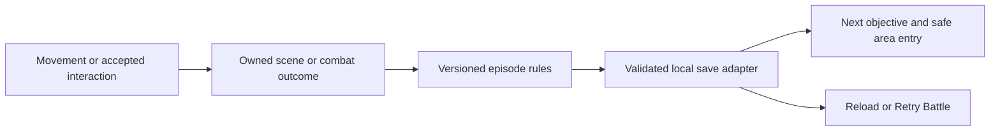

# M2 · Connected David and Goliath episode

11 November 2026. The connected local outline is implemented under the [authorised M2 brief](m2-connected-episode-brief.md) and [current project plan](../roadmap/project-reset-plan.md). **Owner review of pacing, objectives and handoffs is pending.** Segun accepted the David–Saul cinematic as the working presentation reference before this milestone.

**Subsequent owner instruction:** Segun authorised [M3 Chapter 1 production](m3-chapter-01.md) and requested its browser review before Chapter 2 production. This is permission to advance that scoped milestone; later chapter content and release acceptance remain separate reviews.

**Engineering verification:** story rules, production build, full connected desktop journey, portrait/landscape touch and recovery checks, and the existing battle and Saul regressions passed. The in-app browser was opened at the new episode's Begin screen for the owner's playthrough.

[Play the connected episode](http://127.0.0.1:4182/episode.html) · [Accepted standalone Saul sample](http://127.0.0.1:4181/saul.html)

## What to play

Begin the episode, follow the gold marker and objective, and interact once at each story point. WASD/arrows or the touch stick move David; dragging changes the view. E or the contextual button starts an interaction. Timed sequences play automatically and support pause/resume.

| Chapter | Earned actions and handoff |
| --- | --- |
| 1 · The Valley of Elah | Walk to the overlook and survey the opposing hills. |
| 2 · David Arrives | Deliver provisions to the baggage keeper, then greet David's brothers. |
| 3 · The Challenge | Hear the distant challenge and speak with Eliab. Continue into Saul's pavilion. |
| 4 · Preparation | Play the accepted 40-second David–Saul exchange. Separately inspect and set aside the armour, continue to the brook, gather five stones and hit the sling practice target. Practice misses continue the same objective. |
| 5 · David and Goliath | Enter the existing animated duel with the preparation actually earned in this run. Move, aim and throw; evade the telegraphed spear. A miss does not fail the run. A lethal strike by Goliath offers Retry Battle. |
| 6 · Victory | The confirmed sling hit opens the aftermath. Watch the fall and retreat, then reach the locally saved completion screen. Replay creates a separate run and retains the prior result. |

The route is a **connected outline**, as required by M2. The accepted Saul performance remains voiced. Other new story cues use temporary caption summaries and reused character candidates. Armour fitting/refusal is currently a timed inspection/acknowledgement and state change; a fitted armour model and its full acting are M3 production work. The practice target and camp props are development assets. This milestone does not imply final art, new voice performances, cheering crowds or finished chapter cinematics.

## Implementation delivered

| Task | Output | Verification |
| --- | --- | --- |
| M2-01 · Versioned story rules | One episode ID, immutable outline content version, six chapter names and 12 ordered objectives. Inventory and current chapter are derived from accepted progress. | Rule tests reject early battle completion, invalid defeat, skipped objectives and inconsistent snapshots. |
| M2-02 · Checkpoints and save adapter | Async typed local adapter, revision checks, Web Locks serialization where available, validated snapshots and one-write progress updates. | Failed writes preserve prior in-memory and stored progress; retry, reload and stale-write tests pass. |
| M2-03 · Cue ownership | A cue token belongs to one run, revision and objective. Restart cancels the owner; only a completed owned cue grants credit. | The opening cue was interrupted, restarted and left running beyond its old completion time without granting progress. |
| M2-04 · Connected exploration | Overlook, delivery, brothers, challenge, Eliab, brook gathering and player-aimed sling practice. | The browser journey earned each objective through its actual movement and interaction controls. |
| M2-05 · Retain and integrate Saul | Original voiced exchange plus ordered armour actions, checkpoint resume and brook handoff. The standalone sample remains available. | Full connected playthrough completed the conversation and both armour interactions. Standalone regression evidence is linked below. |
| M2-06 · Actual battle preparation | Optional episode setup supplies real preparation and attempt state to the existing duel. The old fixture remains explicitly separate. | The connected test observed delivered provisions, declined armour, five stones and sling readiness in the battle state. Direct battle URLs cannot seed these flags. |
| M2-07 · Defeat, aftermath and replay | Battle-only lethal defeat; safe entry retry; saved aftermath; one terminal episode result; replay with previous completion retained locally. | Browser tests cover a miss, lethal defeat, reload, retry, winning hit, aftermath reload, completion and replay. |
| M2-08 · Responsive review and recovery | Desktop and emulated touch checks, captions, visible checkpoint status, save-error feedback and Back-navigation reload of the latest checkpoint. | See the actual test records below. |

## State and save behaviour

The browser entry is [episode.html](../../apps/playcanvas/episode.html). The [story definition and reducer](../../apps/playcanvas/src/gameplay/episode-rules.ts) own progression independently of PlayCanvas. The [session and save adapter](../../apps/playcanvas/src/gameplay/episode-session.ts) own writes and cue tokens. [Episode routing](../../apps/playcanvas/src/app/episode-route.ts) connects the world, Saul and battle entries on the same origin.

The local key is `bible-comic.episode.local.v1`. A run records schema/content versions, run ID, revision, ordered objectives, active/defeated/completed status, battle attempt/defeat counts and timestamps. Named entries are derived from the next objective: `valley.entry`, `camp.entry`, `challenge.entry`, `saul.entry`, `brook.entry`, `battle.entry`, `battle.aftermath`, then `episode.complete`. No per-frame player position, unfinished animation or flying stone is saved.

- Reload during an unfinished scene restores its safe objective entry; it does not complete that scene.
- Each successful objective is saved before exposing the next objective or routing to its area. Loading a destination is independently retryable; no destination interaction credit is granted by the handoff itself.
- Defeat preserves the earlier objectives and five-stone preparation. Retry records a new battle attempt and resets combat at `battle.entry`.
- A successful hit saves `battle.aftermath`. Reloading there replays the safe retreat rather than asking the player to win the fight again.
- Scene completion commits the episode once. Replay keeps up to the last 20 completed-run summaries in this local development adapter.
- Save failures stop progression at the current boundary, explain the problem and offer Retry save or Reload checkpoint. Changed progress in another tab requires reloading its checkpoint.
- Unknown versions, corrupt JSON and invalid objective sequences are refused and left intact. Automatic migration or a UI to replace a corrupt record is not implemented; that remains a version/recovery decision before release.

This is a **browser-local development adapter**, not authenticated or tamper-resistant cloud persistence. It has no account ownership or cross-browser resume. M4 must implement those requirements through the typed boundary with server validation. The local result summary is not the final database's full mission-attempt history.

## Executed verification

- `npm.cmd --prefix apps/playcanvas run test:story` — **passed** on the installed Node 24.14.1. Uses Node's TypeScript support. Covers objective ordering, idempotency, cancelled/stale cue ownership, failed and stale writes, reload, preparation, defeat/retry, aftermath, completion, replay and malformed/incompatible snapshots. [Test source](../../apps/playcanvas/tests/episode-rules-check.cjs).
- `npm.cmd --prefix apps/playcanvas run build -- --outDir ../../build/playcanvas-m2` — **passed**, including TypeScript checking and all five browser entries. Vite retains the existing shared-engine chunk-size warning.
- [Connected browser test](../../apps/playcanvas/tests/episode-browser-check.cjs) — **passed**, Chrome 157.0.8103.39, desktop 1366 × 900. All 12 objectives were earned with the actual controls; no preparation snapshot was injected into this main journey. Includes simulated save failure/retry, interrupted cue, reload, practice miss, combat miss, defeat, retry, aftermath recovery and replay. [Results](evidence/m2-2026-11-11/browser-results.json).
- [Touch and recovery test](../../apps/playcanvas/tests/episode-touch-check.cjs) — **passed**; see [results](evidence/m2-2026-11-11/touch-results.json). Tests actual touch movement, opening interaction and pause/resume at 390 × 844 and 844 × 390, direct-route guards, readable layout and 48-pixel essential buttons. Its Saul-resume layouts deliberately use valid checkpoint fixtures; they are not reported as full mobile playthroughs. Includes corrupt-record preservation and Back-navigation recovery. An initial Back fixture had no preceding game history and returned to `about:blank`; the corrected test supplies a distinct earlier game URL and verifies the current replay checkpoint after Back.
- Existing [battle regression](../../apps/playcanvas/tests/battle-check.cjs) — **passed** on the M2 production build, desktop and emulated touch. Includes animation, spear telegraph, sling, audio pause, fall, retreat, defeat and retry. [Results](evidence/m2-2026-11-11/battle-regression/results.json).
- Standalone Saul regression on the M2 build — **passed**; see [results](evidence/m2-2026-11-11/saul-regression/browser-check.json) and [script](../../tools/saul-cinematic-check.cjs). The original frozen M1 preview was preserved separately.

Captures: [opening](evidence/m2-2026-11-11/01-valley-entry.png), [recoverable save error](evidence/m2-2026-11-11/02-recoverable-save-error.png), [defeat](evidence/m2-2026-11-11/03-defeat-with-preparation.png), [completion](evidence/m2-2026-11-11/04-episode-complete.png), [portrait opening](evidence/m2-2026-11-11/05-portrait-opening.png), [landscape opening](evidence/m2-2026-11-11/05-landscape-opening.png), [portrait Saul resume](evidence/m2-2026-11-11/06-portrait-saul-resume.png), [landscape Saul resume](evidence/m2-2026-11-11/06-landscape-saul-resume.png).

No physical-phone/Safari performance result, unaided user session or full-episode startup/frame-pacing result is claimed. The PC-04 measurements are not reused as measurements of this larger route. These remain later verification work. No new paid service, deployment, commit or push was performed.

## Next review and implementation

Segun should play the connected route and judge the objective order, chapter pacing, control handoffs and retry behaviour. Record specific revisions against this outline. Once that route is accepted, M3 produces the chapters in order, beginning with the Elah opening: reviewed environment composition, camera reveal, soldier activity and sound, while retaining the accepted Saul presentation as the working cinematic reference.
