# Character motion, speech and guided journeys

19 November 2026 · Implementation proposal · Baseline: `2e96ba6` on `main`.

This plan was prepared after source and implementation-record review, before the MSR-01 browser assessment. No gameplay, audio, assets, saves or deployment settings have been changed by the plan or MSR-01. The initial source risks are distinguished below from the later reproduced findings linked in the status update.

**MSR-01 update, 19 November:** the [browser baseline and prioritised defect log](../quality-review/motion-speech-and-route-baseline.md) are ready. The fresh six-chapter run completed and motion/route issues were reproduced. Pronunciation and emotional voice delivery still require an audible listening review; that limitation is recorded explicitly. No gameplay fixes have started.

**MSR-02 update, 20 November:** [motion fixes and browser evidence](../quality-review/msr02-motion-foundation.md) are ready for owner review. Jesse/camp end-pose holds are repaired; David's story movement now blends idle/walk from actual travel and eases bounded body turns. Desktop, portrait and landscape checks and a fresh six-chapter desktop regression passed. MSR-03–08 have not started; voice delivery and new walking connections remain outside this completed technical pass.

**MSR-03 update, 20 November:** [speech/reactions pilot](../quality-review/msr03-speech-and-reactions.md) implemented with three intonation-directed takes after the owner's clarification, restrained mouth movement, forward gestures and a cinematic dialogue mix. Desktop/touch core checks and a fresh six-chapter desktop run passed. **Owner listening approval and native tab-away/resume remain open**; the native UI check was stopped by automatic approval review. MSR-04 was subsequently authorised explicitly; proceeding with it does not close those earlier gates.

**MSR-04 update, 20 November:** [Eliab → Saul connection](../quality-review/msr04-eliab-to-saul-connection.md) implemented: confirmed save → player-guided camp departure → covered transfer → player-guided pavilion approach → Speak. Frozen-build desktop/portrait/landscape route checks, seven failure/reload scenarios and a fresh six-chapter desktop run passed. The connection measured about 6.6–7.9 seconds of purposeful walking. The owner's subsequent instruction to proceed with MSR-05 authorised the wider rollout below; it does not silently close earlier voice/native gates.

**MSR-05 update, 20 November:** [remaining connected journeys](../quality-review/msr05-connected-journeys.md) implemented for R03/R05/R09/R11, with R06's bent guide and contextual camp instructions. All twelve desktop/portrait/landscape route checks and fourteen recovery scenarios passed; purposeful walking measured about 5.3–8.9 seconds. The portrait practice-bank footer clipping was fixed. A fresh six-chapter desktop regression passed all twelve objectives, checkpoints, battle retry and replay. MSR-06–08 remain planned.

**MSR-06 update, 20 November:** [remaining cast motion/speech polish](../quality-review/msr06-cast-performance.md) implemented and browser verified. Fifteen desktop/portrait/landscape performance checks and a fresh normal six-chapter regression passed. David’s faith-response tail, scripted turns and foreground crowd-mouth ownership are repaired; restrained faces, listener beats and cinematic dialogue routing extend the Saul treatment. Owner listening/visual acceptance and the earlier native/foot/input gates remain open. MSR-07/08 are not started.

**MSR-07/08 update, 20 November:** [integrated engineering validation](../quality-review/msr07-integrated-validation.md) passed on the final local/cloud candidates, including real hosted progression, both complete touch journeys, route/audio recovery, laptop combat and Edge resume. Victory startup now has a bounded retry. The [review guide, frozen manifest and handover](motion-speech-and-guided-routes.md) are ready. The owner requested a GitHub push, confirmed no first-time participant is available today and has not reviewed the latest motion/speech. These human acceptance gates remain open; this is a conditional review candidate.

## Intended result

David and the other characters move, speak and react naturally within the existing art style. Players understand where to walk and experience departures and arrivals between the existing locations. The six chapters remain one ordered biblical story, with short guided exploration, voiced encounters and the existing player-controlled fight.

Recommended scope: connect the existing story locations with authored, walkable approaches and clear transitions. A large unrestricted world, additional chapters, side quests, new combat systems, an engine migration and replacement of every model/voice are outside this pass. The reviewer's request does not establish approval for those additions.

Retain PlayCanvas **2.24.0**, TypeScript, Vite, Blender/GLB assets, Clerk and Supabase. Animation transitions and layers already exist in the project; PlayCanvas supports cross-fading and masked animation layers, so this work can extend the current approach. Check any newly used API against the pinned installation before implementation. [PlayCanvas animation transitions](https://developer.playcanvas.com/user-manual/animation/playing-animations/) · [Layers and masks](https://developer.playcanvas.com/user-manual/animation/layers-and-masks/).

## 1. Evidence and gaps

| Area | Baseline source or earlier records, before the MSR fixes | Planning implication |
| --- | --- | --- |
| Story and progression | [episode-rules.ts](../../apps/playcanvas/src/gameplay/episode-rules.ts) defines six chapters and twelve ordered objectives. Optional `Run.battle` preserves the new aftermath stages. | Keep these IDs, order, versions and legacy-save behaviour. Travel is presentation, not a new mission requirement. |
| David movement | [movement-area.ts](../../apps/playcanvas/src/world/movement-area.ts) has an idle/walk blend tree and speed-matched locomotion; [ground-motion.ts](../../apps/playcanvas/src/gameplay/ground-motion.ts), shared input and physical jump are already reused. | Tune and selectively reuse the good behaviour. Avoid a broad controller rewrite. |
| Other chapter actors | [conversation-actor.ts](../../apps/playcanvas/src/world/conversation-actor.ts) supports a 0.14-second transition, but clamps sampled time to each clip's duration. Camp, Challenge, the duel exchange and Victory also clamp several speaking gestures to their last frame. | Existing cross-fades should be retained. Long-line pose holds are a source-backed risk, not yet a reproduced visual defect. Audit the callers and the clips together. |
| Saul reference | [audience-performance.ts](../../apps/playcanvas/src/world/audience-performance.ts) already restores additive reactions and continues a speaking gesture. The [17 November record](elah-saul-cinematic-polish.md) documents the accepted direction and browser evidence. | Use this as the quality reference; retain its good lighting, eyelines and reactions. A generic gesture played backwards is not automatically suitable for every hand/prop action. |
| Voice and face timing | [scene-speech.ts](../../apps/playcanvas/src/world/scene-speech.ts) schedules recorded voices and exposes paused audio/cue clocks. Camp, Challenge and Preparation already use those clocks for their main dialogue sequences. | Verify and consolidate the remaining differences; do not diagnose all speech as a frame-clock bug. Preserve functioning pause/mute/resume behaviour. |
| Mouth detail | Existing dialogue generators produce waveform/spectral mouth envelopes at 30 Hz, explicitly **not phoneme alignment**. Actors generally expose `SpeakOpen` and `SpeakRound`. | Improve envelope timing, silence closure and reactions first. Full phoneme-specific lips require a separate rig/content decision. |
| Spatial dialogue | Shared speech captures speaker positions when a sequence begins and updates the listener from the camera. | Check whether camera distance or actor movement causes perceived level/position changes. Treat this as a hypothesis until listened to in the browser. |
| Existing travel | [shepherd-opening.ts](../../apps/playcanvas/src/world/shepherd-opening.ts) separates pasture, courtyard and road stages. [Pasture arrival](pasture-courtyard-arrival.md) records player walking followed by the explicitly requested automatic courtyard arrival. | Preserve that flow, the automatic messenger and Jesse's separate Speak/Take actions. It is the reference for a readable departure and arrival, not something to rebuild. |
| Navigation | [objective-guide.ts](../../apps/playcanvas/src/app/objective-guide.ts) and [route-path.ts](../../apps/playcanvas/src/gameplay/route-path.ts) already project chevrons along supplied polylines. Some short routes use a direct line. | Supply real walkable paths for bends/obstacles and keep the existing arrows/off-screen destination cue. |
| Chapter handoffs | Valley → Camp, Camp → Challenge, Challenge → Preparation and Preparation → Duel still navigate with `location.assign` from chapter controls. | Add player departures and matching destination arrivals around these boundaries; keep deep links and chapter review. |
| Pavilion → brook | `beginBrook()` in [preparation-main.ts](../../apps/playcanvas/src/app/preparation-main.ts) activates a different root and sets David's new position. [preparation-world.ts](../../apps/playcanvas/src/world/preparation-world.ts) already separates both roots. | Add a walk to the pavilion exit before the switch and an arrival at the brook. Never expose the coordinate relocation. |
| Loading | Earlier profiling identified shader-link stalls and added Elah/brook preparation. | Preserve warm-up/restoration. Network prefetch does not carry compiled GPU programs into another page's new graphics context. |
| Latest battle | [Continuous combat report](continuous-combat-aftermath.md) records the staged fall, player sword action, saves, four browser layouts and full episode checks. | Protect the combat mechanics and use the evidence as a regression baseline, not proof that the reviewer's new concerns are resolved. |

Earlier Godot/no-login documents are historical; they do not override the current PlayCanvas/account implementation or this scope. Physical-phone testing is not a prerequisite added by this plan: use the owner's requested desktop and responsive mobile browser checks, and label emulation honestly.

## 2. Story contract

| Chapter | Required story retained | Existing objective IDs retained |
| --- | --- | --- |
| 1 · The Valley of Elah | David tends the flock; messenger arrives automatically; player follows the path; automatic courtyard arrival; Jesse gives the errand; separate provisions pickup; road and Elah reveal. | `valley.surveyed` |
| 2 · David Arrives | Deliver provisions to the keeper and meet David's brothers. | `provisions.delivered`, `brothers.met` |
| 3 · The Challenge | Hear Goliath and answer Eliab. | `challenge.heard`, `eliab.answered` |
| 4 · Preparation | Speak before Saul, try/decline armour, walk towards the brook, automatically gather five stones and practise the sling. | `saul.audience`, `armour.inspected`, `armour.declined`, `stones.gathered`, `sling.practised` |
| 5 · David and Goliath | Entrance and confrontation; player survives sword/spear attacks; continued spear danger while aiming; genuine stone hit/miss; staged fall; player retrieves/readies/uses the sword with a non-graphic finishing presentation. | `goliath.struck`; retain `battle` checkpoint stages and their guards. |
| 6 · Victory | Existing retreat, cheering soldiers, voiced conclusion, completion and replay. | `victory.witnessed` |

```mermaid
flowchart LR
  C1["1 · Flock, Jesse, road and Elah"] -->|"Walk towards the camp"| C2["2 · Provisions and brothers"]
  C2 -->|"Follow the camp path"| C3["3 · Goliath and Eliab"]
  C3 -->|"Walk to Saul's pavilion"| C4["4 · Audience, armour, brook and practice"]
  C4 -->|"Walk towards the battlefield"| C5["5 · Fight and final sword action"]
  C5 -->|"Confirmed final action; cinematic handoff"| C6["6 · Retreat, cheers and conclusion"]
```

No walking trigger grants `challenge.heard`, `saul.audience`, `stones.gathered`, a battle hit or Victory. Existing scene completion/interaction/collision conditions remain responsible for those objectives.

## 3. Location and route inventory

New inter-location walks should take approximately **5–10 seconds of purposeful movement**, excluding pauses, exploration, loading and cinematics. Measure the complete connection, including departure and playable arrival; do not count only its shortest half. At the existing common 1.35 m/s speed, roughly 6.75–13.5 m is an initial total path-length guide, subject to real collision/camera testing. Nearby object interactions should stay shorter instead of being padded to five seconds.

| Route | Change | Player control and presentation | Dependency / boundary |
| --- | --- | --- | --- |
| R01 · Flock → Jesse's courtyard | Audit existing path; improve motion/turns only where observed. | Player follows arrows, then retains the already requested automatic gate arrival. | Preserve messenger timing, automatic exit trigger and separate Speak/Take. |
| R02 · Courtyard → ridge → Elah | Retain existing journey; audit foot contacts, provisions carrying and the scene reveal. | Existing player walks and discovery beats remain. | Preserve Chapter 1's first durable checkpoint at the survey. |
| R03 · Elah survey → baggage camp | New visible departure and arrival. | After the survey saves, return movement with “Follow the path to the camp”; crossing the valid exit starts the handoff. | `camp.html` enters at its authored approach, not a copied world coordinate. |
| R04 · Keeper → brothers | Refine the existing camp-aisle polyline and camera. | Player walks; no repeated interaction to advance the route. | Existing provisions/greeting objective gates. |
| R05 · Brothers → challenge overlook | New departure through the camp and matching overlook arrival. | Clear path and distant ranks/horns; no compulsory new dialogue. | Save `brothers.met` before enabling departure. |
| R06 · Overlook → Eliab | Add/verify an obstacle-aware route for the existing short walk. | Clear destination and follow camera; conversation still requires its existing action. | `challenge.heard` precedes the Eliab exchange. |
| R07 · Eliab → Saul's pavilion | **First connected pilot.** Add a short camp-edge route and pavilion approach using existing dressing. | Player leaves Eliab, follows arrows, arrives outside the pavilion and walks to Saul. Speak starts the existing audience. | After confirmed `eliab.answered`; Chapter 4 reads the canonical `saul.audience` goal. |
| R08 · Saul → armour | Keep the existing short local movement; improve orientation and prop contact. | Preserve Speak, Try armour and Set aside actions. | No forced minimum walking time inside the pavilion. |
| R09 · Armour refusal → brook | Replace the immediate relocation with an exit walk and matched brook arrival. | Player walks out after the refusal saves; a brief covered transition changes roots; control returns on the brook path. | Preserve prepared brook shaders, automatic stone collection and its existing interruption semantics. |
| R10 · Stones → sling practice | Retain the local approach and improve guidance/camera return. | Stone picking remains automatic; the player walks to and starts practice as before. | All five stones still save together. |
| R11 · Practice → battlefield | New route towards the field with a compatible duel entry. | Player leaves the practice bank; existing Goliath entrance/confrontation and control handoff remain in order. | After confirmed `sling.practised`; no route can start attacks, bypass the challenge or arm the sling early. |
| R12 · Fallen champion → sword → final action | Keep and regression-test the new routes and interaction distances. | Player walks and deliberately picks up, readies and finishes. | Maintain all battle checkpoint and duplicate-action guards. |
| R13 · Battle aftermath → Victory | Retain the cinematic chapter transition; match exit/entry staging and audio. | No extra mandatory walk after the final action. | Only confirmed `finished` metadata, or the existing supported legacy flow, permits Victory. |

The table records the intended route contracts. Authored coordinates, implemented behaviour and actual measurements are now in the [MSR-04](../quality-review/msr04-eliab-to-saul-connection.md) and [MSR-05](../quality-review/msr05-connected-journeys.md) reports. R11 retains the established cinematic field entrance and subsequent encounter approach; its new connection timing measures the playable bank departure, with no added forced walk before that cinematic. Regional camp/road materials and scenery are reused; decorative posts and stones stay outside the walking centre.

## 4. Implementation architecture

### Motion and performance

- Keep the ground controller, collision, jump and combat calculations authoritative. Sample walk phase from distance actually travelled after collision; tune starts/stops and turning against that distance. A blocked character must not continue walking at full stride.
- Extend the existing animation helpers with small, explicit policies for looping locomotion, one-shot actions, sustained speaking and listening. Start with one chapter and reusable helpers; avoid replacing all chapter coordinators at once.
- Use appropriate short transitions (initial tuning range 0.15–0.25 seconds) and preserve gait phase where practical. Check walk → stop → turn → speak → listen → move. Combat attack/release timings are excluded from this generic retiming.
- Keep full-body actions separate from additive head/chest reactions and upper-body gestures. One owner writes each transform per frame; restore additive offsets before resampling. Preserve the existing masked sling layer and physical jump/dodge behaviour.
- Review prop contacts against the actual hand/foot joints. Repair a small authored clip when blending cannot fix an incorrect contact. Preserve scale, rig names, speech morphs, appearance vertex colours and licences when exporting derivatives.

### Speech and presentation

- Audit every line's recorded duration, scheduled start, mouth envelope and gesture range. Use the paused cue clock for blocking dialogue, captions, gestures and camera beats; keep the independent movement/combat simulation authoritative during interactive play.
- Existing main conversations already follow audio clocks. Verify actual drift before changing them. Compare metadata against decoded recording duration, detect missing/invalid mouth samples, and make completion wait for the required line tails.
- Evaluate delivery by listening: pronunciation, pace, emphasis, emotional intent and turn-taking. Start with existing recordings; propose individual replacements only for identified problems. Estimates below allow up to four short line revisions, not a complete rerecording. Retain character voice identity and record usage rights/provenance for any replacement.
- Improve silence closure and open/round envelopes using the existing morphs. Review listeners' eye direction, nods, breathing and reactions; ensure only the intended speaker is visibly speaking. Reuse the Saul performance where suitable, but author an intentional return/hold for gestures that cannot naturally reverse.
- Separate conversation intelligibility from environmental attenuation. Measure whether camera changes or moving speakers cause volume dips; then choose a restrained dialogue mix policy while keeping environmental sounds spatial. Ensure one sound setting covers every new bus/source.
- Cancel pending speech and reset face/gesture state on restart, route transfer and scene disposal. Resume only the current cue after pause/tab return, with no duplicate line or skipped conclusion. Retain a direct-user-gesture audio start and bounded retry UI.

### Guided travel and loading

Use a small route descriptor per connection: route ID, allowed story goal, source/destination scene, walkable waypoints, trigger radius, departure/arrival anchors, camera hints and location sound profile. Keep actual geometry/collision definitions with the relevant scene. Reuse `routeAhead` and the existing projected guide.

Suggested route presentation states:

`available → walking_departure → preparing_destination → covered_transfer → walking_arrival → arrived`

`preparing_destination` may begin opportunistically while walking, but it does not lock or move David until the grounded exit condition is met. Keep loading covered until the destination is ready. On failure, show Retry loading / Return to saved checkpoint; never expose an unfinished world or advance an objective to escape an error.

- Retain separate page entry points, dashboard navigation and chapter reviews for this pass. Add departure/arrival adapters rather than a new all-chapters world application. Remove mandatory “Continue” interruption where walking supplies the handoff; retain chapter summary/review access as secondary UI.
- At an existing chapter boundary, save the completed objective first. The source page can then offer its departure route even though the next objective belongs to the destination. Refreshing the source must still route safely to the canonical current chapter, not revive an obsolete scene owner.
- If necessary, a short-lived session navigation hint may carry route ID and requested arrival anchor, bound to run ID, content version, current run/battle revisions and destination. Validate it against confirmed progress and consume it once. It is not trusted progress and contains no credentials. A missing/stale/malformed hint uses the normal safe entry.
- Same-page pavilion/brook transfer can retain its application/context and switch roots behind cover. Across pages, match landmarks, lighting, time of day, wardrobe, carried items, facing and camera before returning control; do not transfer raw coordinates between unrelated worlds.
- Clear held movement, aim, jump and interaction requests during a covered transfer. Resume input only when the arrival is ready; preserve any explicit manual pause. Require the normal initial sound gesture on a fresh/direct chapter entry.
- Verify sound activation on normal cross-page handoffs in the pilot as well. If a destination audio context is blocked, hold its voiced sequence and show a clear Enable sound action; never run a silent conversation to completion. Browser audio policies require user interaction in relevant cases. If Segun requires zero arrival gestures on a browser that blocks this pattern, review a persistent game-runtime alternative separately rather than promising that page navigation preserves activation. [PlayCanvas browser audio guidance](https://developer.playcanvas.com/user-manual/audio/).
- Fetch only the next connection's necessary code/assets opportunistically and reuse the browser cache. Retain destination shader preparation and bounded active roots; loading bytes in advance is not cross-page GPU warm-up. Fade ambient sound across same-page roots; across pages use a matched fade-out/in and do not promise uninterrupted audio across document teardown.
- Use one-shot route ownership and grounded/allowed-area checks. Stopping, turning back or leaving the path must not fire the exit early. Decorative NPCs must not block or collide unpredictably with David.

No new database table, chapter, reward, authentication feature or save migration is planned. If the pilot proves that a durable mid-route checkpoint is essential, document the exact failure and propose an additive design separately; do not silently alter the current cloud schema.

The implementation now uses `gameplay/story-route.ts`, `app/story-departure.ts` and MSR-04's `app/guided-handoff.ts`. The pilot's R07 contract remains intact. Existing scene owners still control movement, dialogue and saves; no all-chapters runtime rewrite was needed. MSR-01's baseline remains historical; MSR-08 should write `docs/implementation/motion-speech-and-guided-routes.md`, with captures/recordings under ignored evidence directories.

## 5. Phases and execution order

**MSR-01's baseline and MSR-02's motion implementation/browser verification are complete. MSR-03 is implemented and core-verified, with owner listening and native lifecycle acceptance pending. MSR-04 is technically verified and rollout was authorised. MSR-05 implementation, route/layout/recovery checks and fresh full regression are complete. MSR-06 cast polish, fifteen focused browser checks and its fresh full regression are technically complete; owner listening/visual acceptance remains open. MSR-07 engineering verification and MSR-08 handover are complete; human acceptance remains open.** The estimates below are the original planning allowances, not a record of hours spent. Effort is hands-on engineering/content time, with one implementation stream working with Segun and no dedicated external artist. It includes targeted tuning, up to two small existing-rig clip repairs and four short voice revisions. Larger content repair needs a re-estimate from the baseline findings.

| Phase / task | Priority | Goal, tasks and concrete output | Prerequisites | Estimate | Exit evidence |
| --- | --- | --- | --- | --- | --- |
| 1 · **MSR-01: Capture and diagnose** · Browser baseline/log ready | P0 | [Review and ranked defect log](../quality-review/motion-speech-and-route-baseline.md): full fresh six-chapter run, focused pose/audio-output captures, route gaps and source inventory. Subjective pronunciation/emotional delivery remains a listening item. | Baseline `2e96ba6`; isolated local QA and review contexts. | Original allowance 4–6 h | Five prioritised findings have reproduction/evidence/next actions; no P0 progression blocker reproduced. No game fixes or subjective listening pass claimed. |
| 2 · **MSR-02: Motion foundation** · Browser verified; owner review pending | P0 | [Implemented motion policies and browser report](../quality-review/msr02-motion-foundation.md): David's idle/walk blending and eased turns; Jesse/camp gestures and listener reactions; existing clips reused. | MSR-01 motion baseline. | Original allowance 6–10 h | Actual keyboard/touch movement, stop/reversal, blocked idle, jump, carrying and complete conversations passed on desktop and both touch orientations. Fresh six-chapter desktop regression passed. Owner judges naturalness; formal device-wide foot-contact/input-latency certification is not claimed. |
| 3 · **MSR-03: Speech and reactions pilot** · Core verified; listening/native lifecycle gates open | P0 | [Revised three-line intonation sample and report](../quality-review/msr03-speech-and-reactions.md); audio-derived score, reactions, restrained mouth movement and opt-in dialogue mix. Originals retained. | MSR-01 speech baseline and MSR-02 motion policy. | Original allowance 6–10 h | Desktop/portrait/landscape core checks and fresh six-chapter regression passed. Owner still judges intonation; native tab-away/resume was not verified because the regular-browser check was blocked by automatic review. |
| 4 · **MSR-04: Eliab-to-Saul connected sample** | P0 | Implemented and technically verified R07 descriptor, collision passage, arrows, covered handoff and validated one-use hint. Production sample, three-layout/recovery and fresh six-chapter evidence: [MSR-04 report](../quality-review/msr04-eliab-to-saul-connection.md). Owner review pending. | MSR-02/03 and confirmed `eliab.answered` → `saul.audience` contract; earlier subjective/native gates remain open. | Original allowance 6–10 h | Total purposeful walking approximately 5–10 s; no visible relocation, early dialogue or lost control. Failed load/reload keeps the correct goal. Owner sees motion, speech and connected travel together before wider rollout. |
| 5a · **MSR-05: Connect remaining locations** | P0 | Implemented four remaining connections, modest regional path dressing, contextual camp hints and the R06 guide. [Complete inventory and evidence](../quality-review/msr05-connected-journeys.md): twelve layout checks and fourteen recovery scenarios passed; fresh six-chapter desktop regression passed. | MSR-04 technical pass; rollout explicitly authorised by the owner. Earlier subjective/native gates remain separate. | Original allowance 12–20 h | Every new connection works with actual controls, sensible arrows, safe loads, both orientations and checkpoint recovery. Existing automatic courtyard arrival/stone pickup and battle entrance remain in order. Owner presentation review remains required. |
| 5b · **MSR-06: Apply performance polish to the cast** | P0 fixes / P1 embellishment | Apply measured fixes to Jesse/messenger, keeper/brothers/Eliab, Goliath/soldiers and Victory; align gestures, listener reactions, prop contacts and camera handoffs. Output per-chapter comparison and resolved defect log. | MSR-03 quality direction; coordinate with MSR-05 per chapter. | 8–14 h | No observed critical speech/motion issue remains without a resolution or explicit owner disposition. New ambient reactions are restrained, varied and within the measured scene budget. |
| 6 · **MSR-07: Full integration and player review** · Engineering passed; human review pending | P0 | Run fresh Chapters 1–6, chapter reviews, saved checkpoints, route interruption/load failure, defeat/retry and completion/replay. Test desktop/laptop and portrait/landscape touch, cold/warm loads and frame pacing. Run an unaided first-time session and owner comparison. Output test matrix and final release-blocker list. | MSR-05/06 integrated candidate. | 8–12 h | Quality gates below pass with evidence. No new progress blocker, duplicate cue, control lock, console/asset/shader error or unhandled save failure. Mobile emulation and hardware evidence labelled separately. |
| 7 · **MSR-08: Review build and handover** · Handover ready | P0 | Freeze the candidate; write implemented changes, measurements, remaining limitations and a short play guide; show the full result in the browser. Output final report, asset/voice provenance updates and review links. | MSR-07. | 2–4 h | Segun can play the candidate, compare the targeted moments and see unresolved decisions. Commit/push/deployment occurs only when requested. |

Total: **52–86 hours**, plus approximately 20% integration reserve (**62–103 hours**, about **8–13 working days at eight focused hours/day**). These are estimates, not a delivery promise or a newly agreed release date. Owner review, participant availability and external asset work are additional dependencies. The connected pilot through MSR-04 is **22–36 hours** before reserve.

If the earlier five-day limit still applies to this new work, target MSR-01–04 plus limited critical fixes and verification in that window; do not claim the complete cross-chapter pass fits it. Re-estimate the remainder from the pilot's actual defect count and results.

Critical path: **MSR-01 → MSR-02 → MSR-03 → MSR-04 → MSR-05/06 → MSR-07 → MSR-08**. Within Phase 5, finish route and performance edits together for one chapter before moving to the next. Voice listening/content notes and static path sketches can be prepared independently; concurrent edits to `scene-speech.ts`, chapter coordinators, shared controllers or the same GLB are avoided. This plan assumes one implementation stream, not undisclosed parallel staffing.

## 6. Quality gates and verification

The numerical tolerances below are **proposed targets for review**, not historical results or universal device guarantees. Establish a matched baseline in MSR-01 and record any revised acceptance threshold explicitly.

| Gate | Acceptance target | Verification and required evidence |
| --- | --- | --- |
| Motion | Natural acceleration/deceleration and orientation; no unintended transform snap or stuck pose. Initial target: planted-foot drift within 8 cm on a measured flat-ground plant, excluding deliberate pivots/jumps; visible response to live movement input within 150 ms on the test machine. | Joint/root traces plus normal-speed and slow-motion browser captures. Check each relevant scale/clip, slopes, blocking walls and stop/turn/speak transitions; owner judges naturalness. |
| Speech timing | Target mouth/gesture/caption cue alignment within 100 ms in the pilot; mouth closes within 150 ms of a line ending or an authored silence. No clipped words, accidental overlap, wrong speaker or unintended level drop at a camera cut. | Inspect actual recording duration, cue/morph traces and browser audio/video. Account for output-device latency rather than claiming log timestamps prove what was heard. Listen through every revised line. |
| Speech delivery | Pronunciation, emotion and pacing suit each character; listener reactions support the exchange without repeating the same gesture continuously. | Before/after examples with sound; Segun accepts the sample. Fix exact lines/poses identified, not merely the number of files touched. |
| Guided walking | New inter-location routes take approximately 5–10 s under purposeful input; local interactions stay appropriately short. Arrows follow a collision-valid path and remain usable when the destination is behind the camera. | Stopwatch/game-clock logs of actual walks in each layout; captures at bends, exits and arrivals. Player can stop/backtrack; no timer automatically walks David to the exit. |
| Transition | Departure and arrival read as the same journey. Any coordinate/root change is fully covered; wardrobe, carried items, facing and sound context are coherent. | Captured full transfer, including slow destination loading, stop before exit, pause during cover, reload and retry. No in-view pop or held-input leakage. |
| Story and saves | Same twelve objective IDs/order, six chapters and battle metadata contract. Route/arrival alone does not complete a story action. Old/defeated/completed saves and isolated reviews remain valid. | Existing rules/SQL checks plus new route ownership/entry-hint tests and real development-account browser save/resume. Compare owned profile/settings and confirmed checkpoints; no owner account state used for destructive QA. |
| Combat protection | Sword/spear stages, continued attacks during aiming, genuine misses/hits, jump/dodge collision, earned fall, player sword sequence and Retry Battle remain functional. | Reuse continuous-battle and physics regressions. Review head/hand markers after any rig edits; aesthetic retiming cannot change physical release/contact without a separately justified correction. |
| Responsive UI | Movement, arrows, captions, objective and action controls are readable/reachable at 390×844 and 844×390, plus desktop/laptop. Minimum 44 px action targets; no control coverage or page overflow. | Real keyboard/mouse and CDP touch interaction, simultaneous movement/aim/action where relevant, and captured geometry checks. Label the tests as emulated mobile layouts. |
| Performance/loading | Aim for at least 30 FPS on the measured baseline. Investigate a >10% regression in matched frame-time/startup/transfer measurements. No playing-story transition frame over 250 ms in the matched local case; network/GPU waits stay behind a meaningful loading state. | Record browser/device/build/scene, median/p95/worst frames, cold/warm loading, transferred bytes and repeated route cycles. Prior 17 November transition results are comparison evidence, not today's pass. Avoid claiming desktop emulation proves low-end phone performance. |
| Player understanding | Suggested pilot: 3–5 first-time participants. Target at least 4 of 5, or all 3 in a three-person pilot, reaching Saul without coaching; no progression blocker for any participant. | Ask players to walk to Saul, explain the instruction and start the audience. Observe wrong turns, pauses, repeated interaction attempts, speech complaints and confidence when control returns. Small samples guide iteration, not population-level claims. |

Existing checks to retain: `npm run typecheck`, `npm run test:story`, `npm run build`; database/save, additive-pose restoration, route/input/jump and collision rules; the full episode driver and continuous-battle browser/live QA suites. Add meaningful tests for new route guards, malformed/stale hints, failed destination preparation and cue cancellation. Update existing drivers to walk the new routes; do not bypass them by calling navigation or advancing saves in the full journey test.

## 7. Owner review and open decisions

| Decision | Recommendation | When needed / status |
| --- | --- | --- |
| D01 · Meaning of connected world | Guided, connected existing locations, with brief covered handoffs where needed. | Proposed here; review the R07 pilot before applying the pattern everywhere. No unrestricted-world expansion assumed. |
| D02 · Character performance target | Natural movement, clear voice delivery and consistent reactions in the current style; use David–Saul as the comparison. | Proposed. Review side-by-side motion/speech samples before broad content edits. |
| D03 · Voice repairs | Owner requested improved intonation in MSR-03; retain the cast and wording, generate a three-line directed sample and keep originals for comparison. | Sample implemented with the existing licensed local model; owner listening acceptance pending. No new service/subscription or full cast change approved. |
| D04 · Facial detail | Improve existing open/round timing and reactions first. Treat additional visemes/facial-rig work as P2. | Revisit only if the pilot remains visibly inadequate. Provide cost/asset implications before proceeding. |
| D05 · Travel length and navigation | Approximately 5–10 s for new connections, arrows plus landmarks, existing movement controls and brief local approaches. | Proposed route-specific lengths; tune after actual walkthrough. Retain the separately approved automatic courtyard arrival and stone pickup. |
| D06 · Chapter completion UI | Walking supplies the normal forward handoff; summaries/review links remain secondary, and direct chapter entry remains supported. | Review with the pilot so chapter completion remains understandable without a mandatory modal. |
| D07 · Time/capacity | Stage delivery around the connected pilot, then reforecast the remaining cast/routes. | No new delivery date committed. Earlier five-day pressure is handled as a reduced milestone, not hidden scope completion. |
| D08 · Numerical gates | Use Section 6 as proposed engineering starting targets, then confirm the measured test baseline and tolerances. | Pending baseline and owner review. Subjective acceptance remains a played/listened review. |
| D09 · Arrival audio activation | Test the existing page-based runtime first; offer an explicit sound-unlock action if required, holding speech until ready. | Resolve in the pilot. A demand for uninterrupted audio and no new gesture across blocked page handoffs may justify a separately estimated persistent runtime. |

Ask the reviewer for a chapter/timestamp or description of “go off” if available. Their answer helps prioritise; it does not block the independent baseline review. Record feedback as exact issues: audio dropout, delivery/pronunciation, mouth mismatch, gesture freeze, foot sliding, camera discontinuity or unclear route.

## 8. Main risks and controls

| Risk | Early warning | Mitigation / owner |
| --- | --- | --- |
| Treating a source risk as the actual defect | Fix proposed without a reproducible clip or audible example. | MSR-01 defect evidence; engineering diagnosis plus Segun's perception. |
| Global animation change breaks props/combat | Hand/forehead marker shifts, altered release timing, or carry/jump locks. | Small opt-in policies, per-character tests, preserved combat clocks and regression gates. Engineering. |
| Overengineering speech | New rig/provider pipeline before testing the existing envelopes and clips. | Fix identified lines/poses first; D03/D04 decisions for larger work. Segun + engineering. |
| Routes create save/entry conflicts | Source page reload loops, repeated arrival cues or an unfinished goal is skipped. | Canonical saved state, one-shot route ownership, validated transient hints, safe fallback and no new route objectives. Engineering. |
| Longer journeys feel like filler | Players hold forward without understanding why or total episode length grows materially. | Keep compressed routes, readable landmarks and sparse relevant activity; measure added time and review pacing. Segun. |
| Loading or audio discontinuity | Shader hitch appears during walking, audible cutoff or silent arrival. | Preserve warm-up, test cold loads, make loading explicit, cancel/restore cue ownership and test sound from the first user action. Engineering. |
| More active actors reduce mobile headroom | Growing draw calls, p95 time or memory after repeated transitions. | Reuse scenery/crowds, keep distant actors economical, bound live roots/resources and compare measurements before adding detail. Engineering. |
| Art/voice work exceeds estimates | More than two clip repairs/four line revisions, unsuitable base rig or extensive rerecording. | Present the measured asset list and re-estimate; do not promise a complete polish pass within a short pilot window. Segun + engineering. |

## First practical development action

**Review the final MSR candidate** using its [play guide and handover](motion-speech-and-guided-routes.md), then record the owner listening/native check and an unaided-player session with the [prepared sheet](../quality-review/msr07-player-review.md) when a participant is available. Engineering validation is complete; these human observations and the formal sole-contact target are not silently waived. The requested GitHub delivery is reported with its revision in the final response.
