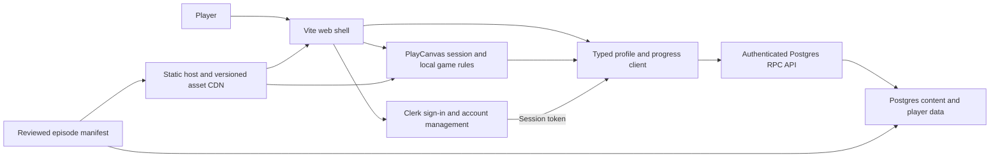
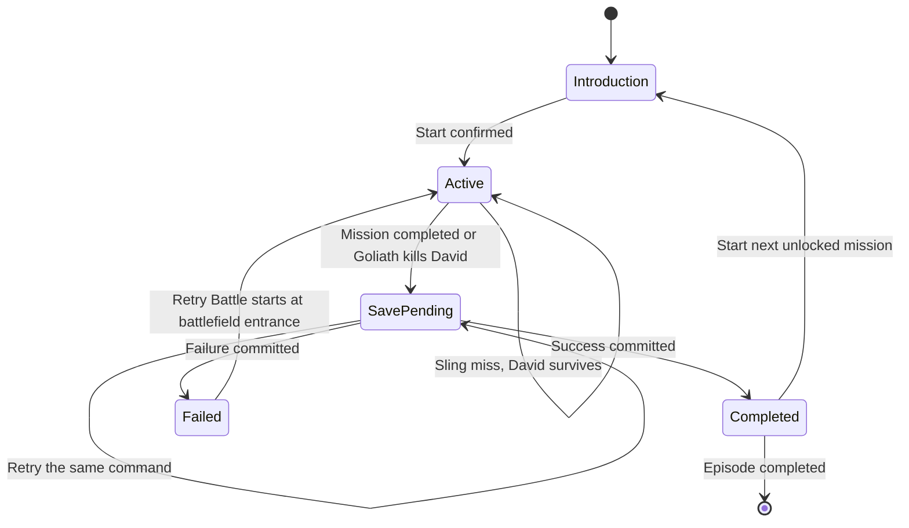

# David and Goliath production blueprint

Use the [11 November reset plan](../roadmap/project-reset-plan.md) for current product scope, six-chapter proposals, mobile requirements and owner review gates. The technical contracts below remain reference designs. Their older chapter and reward assumptions require reconciliation during M0.

**10 November 2026 · Revised proposal for review**

Build one web application that takes a player from account creation to the David and Goliath episode, records mission outcomes, and resumes the episode from the last confirmed checkpoint. Keep PlayCanvas, TypeScript and Vite. The first episode still starts with Jesse's errand in Bethlehem and ends with the Philistines' retreat. David is portrayed at about 15 and can be customised. Future episodes use the same account, mission and save contracts. [Episode design](../story/david-and-goliath-episode-design.md) · [Matched browser comparison](../quality-review/stack-comparison-results.md)

This brief replaces the earlier **no-login and in-session-only save** scope for the production application. The owner selected Clerk for sign-in, Goliath killing David as the only mission failure, and a Retry button that restarts the battle scene. Rewards are deferred. The owner previously selected the engine and authorised PC-01. The local preview and earlier acceptance records describe the prototype. [Original owner decision](a02-decision-record-2026-10-29.md) · [Browser implementation milestones](playcanvas-implementation-plan.md)

## Repository baseline and gaps

| Area | Evidence in the workspace | Work for the production app |
| --- | --- | --- |
| Browser engine and assets | The standalone Vite app mounts a PlayCanvas WebGL 2 test area. The verified build renders teenage David with walk and acknowledgement animations. The appearance editor changes skin tone, curls, hair colour and tunic colour, then remembers the look in browser storage. [Source](../../apps/playcanvas/src/) · [PC-01 evidence](playcanvas-pc01-bootstrap.md) | Mount the game from the signed-in shell. Reuse the GLB, animation and appearance code. Build movement, camera, interactions, areas and the full episode through the existing milestones. |
| World and story | The episode design and game architecture define the story beats, cue ownership and recovery. The Godot proof supplies an existing Jesse exchange, pickup and gate route. [Game architecture](../architecture/playcanvas-game-architecture.md) · [Village proof](q04-village-exchange.md) | Port the route and cue behaviour. Add reusable mission definitions, validated results, retry screens and the rest of the episode. |
| Accounts and application screens | The PlayCanvas package has PlayCanvas, Vite and TypeScript. Its HTML is a single animation preview. Repository inspection found no application auth integration, dashboard, profile or account flows. [Package manifest](../../apps/playcanvas/package.json) · [Entry page](../../apps/playcanvas/index.html) | Add landing, account, dashboard, episode and profile screens and session handling. |
| Progress and data | Browser storage is used for David's appearance. Repository inspection found no game API, database schema, migrations or durable saves. [Current application entry](../../apps/playcanvas/src/app/main.ts) | Add owned account data, versioned content, attempts, checkpoints and transactional result writes. |
| Verification and release | The browser smoke check covers the model, animation, appearance, responsive layout and loading recovery. It targets a local production preview. [Browser check](../../apps/playcanvas/tests/browser-check.cjs) | Add data and auth tests, a hosted staging journey, migration and restore checks, release monitoring and a rollback procedure. |

## Recommended application architecture

| Component | Responsibility and rationale |
| --- | --- |
| **Vite, TypeScript, HTML and CSS** | Extend the existing browser shell for navigation, dashboard, player profile, mission instructions and results. Mount Clerk's prebuilt account components in the shell. Use route-based imports to keep the 3D engine on the play route. The shell owns focus, responsive layout and save messages. [Vite static deployment](https://vite.dev/guide/static-deploy) |
| **PlayCanvas** | Own the world, character, camera, animation and effects. Engine-independent TypeScript owns input, story rules, cues and moment-to-moment gameplay. The game sends named mission commands through a typed adapter at meaningful boundaries. Frame updates, input, aiming and collision stay local. [Game architecture](../architecture/playcanvas-game-architecture.md) |
| **Clerk Authentication** | Use Clerk's prebuilt sign-in, sign-up and account menu with the JavaScript SDK in the existing Vite app. Clerk manages identity, email verification, sign-out, session refresh and recovery for the chosen sign-in method. Keep game profile data in Postgres. [Clerk JavaScript quickstart](https://clerk.com/docs/js-frontend/getting-started/quickstart) |
| **Supabase Postgres and Data API** | Keep Postgres for durable saves and the Data API for profile and progression commands. Use its native third-party Clerk integration to verify the Clerk session token, then resolve the token subject to the app profile. Save checkpoints and results in transactions. [Clerk third-party integration](https://supabase.com/docs/guides/auth/third-party/clerk) · [Database functions](https://supabase.com/docs/guides/database/functions) |
| **Static host and CDN** | Serve the Vite shell over HTTPS. Start with hashed GLBs, textures, animation, audio and content manifests served with the app. Move larger episode packs to versioned object storage behind a CDN when delivery measurements warrant it. Store only asset references and version metadata in Postgres. Keep private files in a separate access-controlled store if uploads are introduced. [Vite static deployment](https://vite.dev/guide/static-deploy) |

Mount one PlayCanvas session per play route. Give it a pinned episode manifest, a server-confirmed run and checkpoint, and the player's appearance and settings. Publish a view model for the shell and dispose engine resources on route exit. Maintain a local fixture for engine development and automated tests. The production game uses the authenticated adapter. Store story definitions, IDs, guards and safe checkpoint anchors in version-controlled episode manifests. Publish the client pack and its matching server-side rules from the same validated source. A new story adds content and any required gameplay mechanics while reusing the application contracts.

## Account, profile and player journey

| Step | Player experience and application behaviour |
| --- | --- |
| **Visit and register** | The landing page explains the game and opens Clerk's prebuilt sign-up or sign-in. Complete the configured email verification in Clerk and open the dashboard after a verified session is available. |
| **Sign in or recover access** | Clerk handles sign-in and recovery through its prebuilt components. Restore a validated in-app return path when authentication succeeds. |
| **Set up a profile** | Create the game profile idempotently on first verified access. Let players change their display name, audio, captions, control and graphics preferences, and David's appearance. Start with initials or a preset account icon. The dashboard shows active progress, completed missions, failed attempts and the episode completion milestone. |
| **Pick an episode** | The dashboard shows published episodes, the current mission, completed and locked missions, and **Start** or **Continue**. Show the first episode with its mission sequence. Retrieve the latest run and confirmed checkpoint before loading a saved game. |
| **Play a mission** | Show a short introduction and the next objective. Mount the relevant world area and handle player actions through the game rules. Show a readable objective update, save status, and feedback for optional actions where present. |
| **See a result** | Show completed or failed status with the reason, progress and the next action. Offer **Continue** after confirmed success and **Retry Battle** after Goliath kills David and the result is saved. If the result is pending, display **Saving…** or **Retry save**. |
| **Return or sign out** | Offer **Continue** from the last confirmed checkpoint after login on another browser. Prompt if the player tries to leave with an unconfirmed save. On logout, clear the session, cached account data and the current game instance. On expiry, pause protected writes, prompt sign-in and resume only after confirming the same account and latest revision. |

Recommended access is a public landing page and a verified Clerk account for the production episode. Restore the Clerk session before fetching player data. Pass the current Clerk session token from the SDK to the Data API on authenticated requests. Limit redirects to known application origins and paths. Offer to import the current browser-local David look only when the account has no saved appearance and the player confirms it. Otherwise use the account's preferences. [Clerk JavaScript quickstart](https://clerk.com/docs/js-frontend/getting-started/quickstart) · [Clerk third-party integration](https://supabase.com/docs/guides/auth/third-party/clerk)

## Data model

Use stable content IDs across episode revisions and pin every run to a published, immutable version. Use UUIDs for player-owned records, UTC timestamps and bounded enumerated statuses. The application reads a small dashboard and resume projection instead of downloading attempt history or checkpoint data for every episode.

| Entity and key | Data, relationships and write point |
| --- | --- |
| **Clerk identity** · token subject `sub` | Clerk owns email, verification, credentials and sessions. The subject is a text identifier. The Data API validates the Clerk token before it can resolve a player profile. Account settings use Clerk. |
| **Profiles** · `user_id` | Internal UUID referenced by game tables. Store a unique `clerk_user_id` text field, display name, optional preset avatar ID and timestamps. Create from the verified token subject on first access. |
| **Player settings** · `user_id` | One row per profile. Captions, audio, graphics, control settings, validated David appearance IDs and settings revision. Update on explicit changes. Handle unsupported IDs with versioned defaults. |
| **Episodes and episode versions** · `episode_id`, `(episode_id, version)` | Stable catalog identity and immutable published versions with title, release status, schema version, manifest hash and asset manifest URL. Editors publish through a reviewed release step. |
| **Mission definitions** · `(episode_id, version, mission_id)` | Versioned introduction, sequence/prerequisites, entry checkpoint, outcome and retry rules, and presentation references. Each mission belongs to one episode version. |
| **Objective definitions** · mission key and `objective_id` | Required or optional, accepted event, prerequisites, result conditions and safe checkpoint reference. Belongs to one mission version. Publish with its mission. |
| **Episode runs** · `run_id` | Owned by one profile. Pin episode/version and track current mission, run status, revision, start and end time. Permit one open run per player per episode. A replay opens a separate run. |
| **Mission attempts** · `attempt_id` | References its run and mission version. Stores attempt number, status, start/end time, terminal reason and optional retry source. One active attempt per run. Terminal outcomes are kept as history, including failures and abandonment. The attempt row is the result record. |
| **Checkpoints** · `attempt_id` | Latest safe snapshot for each attempt. Store checkpoint ID, payload schema version, accepted objectives, relevant story flags and items, and last committed revision and time. Resolve area, spawn and entry mode through the pinned manifest. Freeze the row when its attempt ends. |
| **Player mission progress** · `(user_id, episode_id, mission_id)` | Cross-run completion summary and first completion time, linked to a successful attempt. Update in the success transaction. Current position comes from the active run. Failures remain visible in attempt history. |
| **Episode completion milestone** · derived query | Show first completion in the profile using successful episode runs. |
| **Command receipts** · `(user_id, command_id)` | Request fingerprint, accepted result reference, revision and timestamp. Write in the same transaction as its effect. Deduplicate retries, including initial run creation. |
| **Gameplay statistics** · derived queries | Derive missions completed, successes, failures and retries from owned attempts and summaries. Use server timestamps for elapsed attempt time. Defer per-frame data, input telemetry and separate analytics. |

Enforce foreign keys across the pinned episode, mission and attempt so a save cannot attach to another version or run. Index owned reads by user, episode and recent activity. Use unique constraints for attempt numbers and partial unique constraints for open runs and active attempts. Use checks for terminal status, reason and end timestamp. Keep bounded snapshot fields in JSONB where episodes need different flags, with schema and allowlist validation in the write function. Keep identities, statuses, revisions and relationships in typed columns.

## Mission design and outcomes

The first episode can use three missions with clear boundaries. All three preserve the approved story path and the player's active role in the encounter. Optional discoveries may have their own feedback. Keep them outside the critical path. [Episode beats and controls](../story/david-and-goliath-episode-design.md)

| Mission | Required progression | Success | Failure and recovery |
| --- | --- | --- | --- |
| **1 · Jesse's errand** | Speak to Jesse once, take provisions after the cue, leave the village and deliver supplies at camp. | Confirm delivery, record the result and unlock preparation. | An interrupted cue, pickup or area load is recoverable. Restore the last safe state and preserve the mission attempt. |
| **2 · Prepare for the challenge** | Hear the challenge, speak to Eliab, meet Saul, set aside the armour and gather five stones. | Commit the required preparation and unlock the approach to Elah. | Missing prerequisites keep the objective active with guidance. A loading interruption restores a valid entry point. |
| **3 · Face Goliath** | Enter the battlefield, complete the exchange, aim and deliberately release the sling. On hit, show the fall and retreat. | A valid hit advances to a safe aftermath checkpoint. Completing the closing cue commits mission and episode success. | Only a resolved attack in which Goliath kills David records failure, with reason `david_killed_by_goliath`. A missed shot keeps the battle active. **Retry Battle** starts a new attempt at the battlefield entrance with earlier missions, preparations and stones intact. |

Each mission definition supplies introduction copy, required and optional objective IDs, prerequisites, accepted transition events, permitted terminal reasons and retry anchors. The local game rules resolve a sling miss, a successful hit or a lethal attack. Use one clearly signalled Goliath attack as the first battle prototype, with timing and how David can avoid it to be tested. A miss alone leaves the encounter active. A lethal attack emits one terminal event for the current attempt. The server accepts that event only for the active Goliath battle before the hit is committed. It validates the run, mission, revision, checkpoint and allowed transition before writing it.

**Success** commits the terminal attempt, completion summary, and next mission or episode completion together. **Failure** records Goliath killing David and closes the attempt while preserving the battlefield entry checkpoint and prior mission credit. **Retry Battle** creates a new attempt at that entry, resets the combat state, and preserves supplies and earlier objectives. Restarting a mission from its entry records abandonment if the prior attempt is still open. **Play again** starts a separate run and keeps previous results. Pause, browser close, network errors and invalid inputs leave the current attempt recoverable.

After Goliath kills David, present the defeat without graphic detail, then open a result panel with **Retry Battle** as the primary action. After success, show the completed mission and **Continue** or **Return to dashboard**. Move keyboard focus into the panel, announce the status, and use text as well as colour. Keep the same result and retry action available from the dashboard after a reload.

## API, saving and recovery

| Operation | Server contract |
| --- | --- |
| `get_dashboard`, `get_resume`, `get_attempt_history` | Return the caller's profile and game summary and the published catalog. Resume returns the current run/revision, permitted actions and only the checkpoint needed to resume. History returns a paginated list of attempts and outcomes. Derive the player from the verified auth context. |
| `update_profile`, `update_settings` | Validate allowed fields, lengths and appearance/settings IDs. Use expected settings revision for conflicting edits. Account email and credentials use Clerk. |
| `start_episode`, `start_mission` | Pin a published version, validate catalog and progression eligibility, and create or return the active run/attempt and safe entry snapshot. Use a command ID for repeat requests. |
| `commit_progress` | Receive `command_id`, `run_id`, `attempt_id`, `expected_revision`, event ID and bounded event data. Validate ownership, current attempt and allowed transition, then derive and save the checkpoint. Return the new revision and safe resume summary. |
| `resolve_attempt` | Accept mission completion or the battle's allowed lethal event. In one transaction, update the attempt and run, preserve the safe checkpoint on defeat, apply completion on success, and record the receipt. Return the result and allowed next actions. |
| `retry_mission`, `restart_mission`, `replay_episode` | Validate the previous result or current mode. Retry requires a confirmed defeat and creates the next attempt at the battlefield entrance. Restart and replay use their own entry anchors. Preserve prior results and credit. |

Commit at mission entry, meaningful objective changes and safe area handoffs. Save the battlefield entrance as `battle.entry` before the encounter and retain it through the fight. On hit, commit the aftermath checkpoint. A lethal attack ends the attempt and preserves `battle.entry` as the retry source. Wait for the destination area to be available before committing a handoff. Treat unfinished dialogue, pickup and combat animations as transient. A reload returns to a safe point or the saved defeat screen.

For each progression command, atomically reserve its unique receipt before checking the revision. A concurrent duplicate waits for that transaction. If the existing receipt's ID and fingerprint match, return its recorded result. Reject reuse of an ID with a different request. Lock the run row, check the expected revision and active attempt, validate the transition and commit the effect and receipt together. For run creation, enforce the unique active slot and return the existing eligible run on a concurrent start. When a second tab or browser has moved the run forward, return a conflict and offer **Reload saved progress**. The game discards callbacks from the old session and adopts the server state.

Keep the confirmed checkpoint on the server. Show when a save is pending, confirmed or unavailable. For a transient failure, retry with the same command ID and keep the player at the relevant boundary until confirmation. After reload, use the server's last committed state. If a request reached the server but its response was lost, the server state or receipt confirms the result. If it never arrived, the safe checkpoint is still available. The first release assumes online account and save access.

Use the run's pinned manifest and assets even when a newer version is published. Keep older packs and rules available for supported saves. Test migration for renamed anchors and objective IDs. When a version must retire, apply an explicit, tested mapping to a safe anchor or present a clear restart choice with historic completions preserved.

## Security, data and operations

- Use HTTPS and Clerk's verification, abuse protections and session management. Restrict return URLs to approved destinations and use MFA for production administrators. Test sign-out, expiry and recovery for the configured sign-in method. [Clerk JavaScript quickstart](https://clerk.com/docs/js-frontend/getting-started/quickstart)
- Configure the Data API to trust the approved Clerk instance. Use the verified token subject from `auth.jwt()->>'sub'` to resolve the profile. Use row-level security for player tables and limit progression writes to scoped API functions. Keep privileged write helpers in a private schema with fixed search paths, fully qualified objects, a narrowly granted owner and ownership checks on every operation. Test through the real API with two accounts, an anonymous request and a token from a different Clerk instance. [Clerk third-party integration](https://supabase.com/docs/guides/auth/third-party/clerk) · [Row-level security](https://supabase.com/docs/guides/database/postgres/row-level-security)
- Keep identity tokens, recovery links and secret keys out of logs, the repository and the build. Vite receives public service settings and publishable keys. Use an explicit CSP tested with Clerk, WebGL and the asset host. Render authored and user text safely. [Vite environment variables](https://vite.dev/guide/env-and-mode.html)
- Collect only data needed for accounts, settings and progress. Keep profiles private by default. Decide eligible audience and regions, retention for attempts and receipts, the player data export and deletion process, and the account support owner before opening registration. Include deletion or de-identification of app records and backup expiry in that process.
- Keep separate local, staging and production data. Use Clerk test accounts and a nonproduction Clerk instance for development and staging. Verify the configured sign-in and recovery experience before public release. Record save errors, auth errors, latency and version mismatches with redacted logs. Define alert ownership and support steps. Select and test backup retention and recovery against an agreed recovery objective. [Database backups](https://supabase.com/docs/guides/platform/backups)
- Keep Blender files and export scripts as editable sources and maintain the runtime asset register. Validate clip names, content references, asset size, licence and manifest hash in CI. Load the active area's pack on demand, release previous area resources on handoff and cap rendering as in the browser plan. Cache immutable assets by hash. Keep the app shell and catalog short-lived so a release points to matching content.
- Build the static release from a reviewed version with pinned dependencies. Apply additive, backward-compatible database migrations before publishing assets and opening a new version in the catalog. Stage the same build, migration and content versions intended for production. Smoke test HTTPS, callbacks, email delivery and checkpoints. Roll back the shell and catalog together and keep prior immutable packs and API compatibility. Use a tested database recovery procedure for data incidents.

## Verification and delivery gates

| Test layer | Required evidence |
| --- | --- |
| **Rules and content** | Test prerequisite ordering, duplicate cue completion, a miss with David alive, a lethal Goliath attack, a successful hit, battle retry, replay and invalid snapshot data. Validate manifest, objective and asset references. Run shared event fixtures against client and server rules. |
| **Database and access** | Run migrations on a fresh local database and against staging-like data. Use two Clerk users and unauthenticated access to test row isolation and direct-write denial. Check stale revisions, invalid failure events, and duplicate success and defeat requests. A repeated command yields one result. An interrupted transaction preserves prior progress. |
| **Hosted browser journey** | Use Clerk to register, verify and sign in. Set David's look, save a checkpoint and resume from a second browser context. Miss a shot and verify the mission stays active. Let Goliath kill David, then select **Retry Battle** and verify the battlefield spawn and preserved preparation. Complete the episode and check the saved attempt history. Exercise logout, recovery, session expiry, network loss and release-version mismatch. |
| **Responsive and playable** | Test keyboard/mouse and emulated touch in portrait and landscape. Test account forms, navigation, loading, captions, objectives and result screens as well as the 3D controls. Observe an unaided first playthrough. Record the device/browser configuration and keep layout evidence distinct from hardware performance. Use the existing provisional PC-04 targets for the first interactive area, then set full-episode budgets from measurements. [PC-04 verification](playcanvas-implementation-plan.md#foundation-verification) |
| **Release and recovery** | Freeze a candidate and capture its build, schema and content versions. Record hosted smoke checks, supported browsers, cross-account checks, restore drill and go/no-go. Confirm rollback can open an existing checkpoint and that the prior content pack is still available. |

## Development phases and dependencies

The scene track comes first. Use local play and checkpoints to build the Elah encounter, connect the episode and review how it feels in the browser. After scene acceptance, connect the reviewed episode to Clerk and Postgres through the existing checkpoint and outcome contracts. [Scene development plan](playcanvas-scene-development-plan.md) · [Step-by-step implementation plan](playcanvas-implementation-plan.md#milestones)

| Phase | Work and dependency | Exit gate |
| --- | --- | --- |
| **0–1 · Verified foundation** | SET-01, SET-02 and PC-01–PC-04 provide the baseline, contracts, David preview, movement, camera, touch and timed cue. | PC-04 passed its control, recovery and performance checks. [PC-04 review](playcanvas-pc04-foundation-review.md) |
| **2 · Playable Elah encounter** | Block out the battlefield, build the local duel and retry, and add representative actors, camera, lighting and sound. | Review a playable fight from the battlefield entrance to the retreat in the browser. |
| **3 · Village journey** | Port Jesse, provisions and the gate through PC-05–PC-06. Use local checkpoints and cue recovery. | Speak, Take and Leave work in order. The player reaches the road with the correct story state. |
| **4 · Complete episode** | Add the road, camp, Saul and brook. Connect the reviewed Elah encounter and conclusion to the local journey. | Complete and replay from Bethlehem to the retreat. Battle retry preserves earlier preparation. |
| **5 · Scene acceptance** | Refine animation, camera, sound, captions, environments and feedback. Check the full route with first-time players. Profile the busiest scene and largest handoff. | The owner reviews period atmosphere and battle feel. Browser, accessibility and recovery checks pass. [Scene gate](playcanvas-scene-development-plan.md#scene-acceptance-gate) |
| **6 · Deferred account and save integration** | Connect Clerk, profile data and server-confirmed progress after scene acceptance. Validate ownership and cross-browser resume with the reviewed episode. | An authenticated player resumes from another browser. Miss, defeat, retry and success retain the approved game behaviour. |
| **7 · Staging and release decision** | Freeze the integrated build, content and schema. Complete delivery, data isolation, backup and rollback checks. | Owner records go/no-go using the staged build and reproducible evidence. |

Keep the earlier allowance of **2–4 focused engineering days** for the account and data foundation and **3–5 more** for the saved-mission slice as planning inputs for Phase 6. Re-estimate integration once the scene and checkpoint contracts are exercised in the full local episode.

The critical path runs through the Elah encounter, village and connected episode, then scene acceptance. Reforecast scene work after the Elah blockout and again after the village review. Treat the earlier 30 November decision as a previous planning baseline.

## Decisions for owner review

| Decision | Recommendation and when it matters |
| --- | --- |
| **Access and audience** | Public landing and verified account for episode play. Confirm eligible ages, launch regions, guest/trial expectations and any consent or support requirements before committing to public registration. |
| **Service ownership and budget** | Confirm Clerk and Supabase project ownership, the Clerk sign-in method, a static host and project region before provisioning. Confirm service limits, costs and operational responsibilities against the intended audience. |
| **Profile and preferences** | Start with a private display name, preset icon or initials, and cloud-saved game settings and David appearance. Decide whether to offer local appearance import and whether uploaded images or public profiles are needed later. |
| **Mission and battle tuning** | Review the three proposed mission boundaries, Goliath's attack timing and the result language. Keep replay and retries separate in history. Decide whether individual completed missions can be replayed outside a full run in a later release. |
| **Save and version policy** | Start with one active run per episode, named checkpoints, online saves, and separate replay runs. Confirm how long old packs and save formats are supported and how to handle retirement. |
| **Privacy and operations** | Agree retention, account export/deletion path, backup and restore objectives, support owner and incident handling before accepting public player data. |
| **Release targets** | Confirm browser/device baseline, usability criteria, cost ceilings and release date after the saved-mission and representative journey checks. |

The next scene milestone starts with **SC-01**, the reference sheet and playable Elah blockout. Use the review to set the encounter's scale, route and camera before committing to final animation. [Build order](playcanvas-scene-development-plan.md#build-order-and-review-points)
