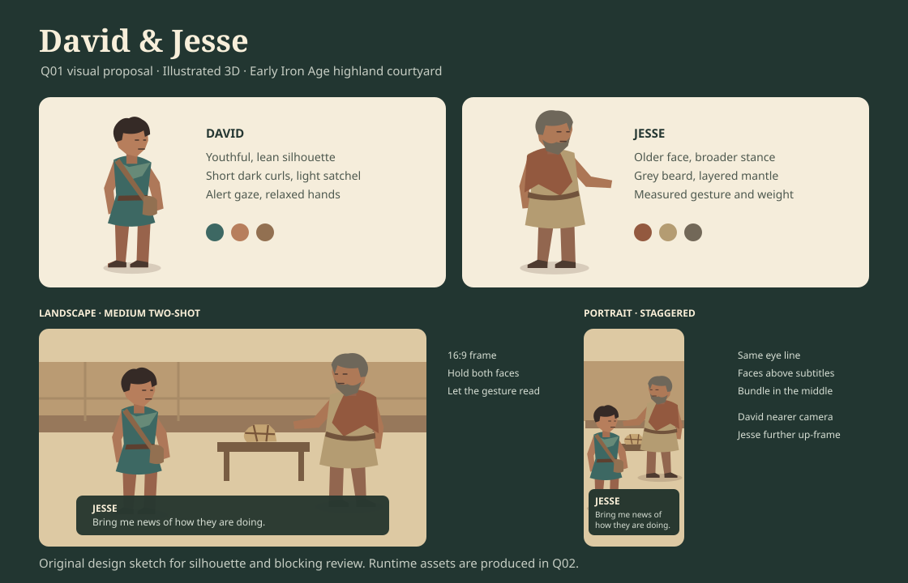

# David and Jesse visual and shot proposal

9 November 2026 · Q01 · Proposed production direction for owner review.

[Rendered storyboard](../implementation/evidence/q01-2026-11-09/shot-board.png)

David reads as a young shepherd from the gameplay camera. Jesse reads as his older father before either character speaks. Their exchange stays in the village world for about 24 seconds. One Speak action starts the scene, and control returns before David takes the provisions.

## Character and courtyard design

| Design | David | Jesse |
|---|---|---|
| Shape | Youthful face, short dark curls, lean shoulders, narrow tunic and a small diagonal satchel | Broader stance, older face, grey hair and beard, mantle that changes his shoulder outline |
| Palette | Muted blue-green tunic `#3D6863`, warm brown leather `#927051`, dark hair | Clay mantle `#93593F`, warm undyed cloth `#B49C72`, stone-grey hair `#726858` |
| Movement | Alert gaze, quick head turn toward Jesse, modest weight shift and a short nod | A settled stance, gradual head turn, one open-hand greeting and one deliberate point toward the bundle |
| Close framing | Visible eyes and brow, relaxed hands, knees and elbows that hold their volume when bent | Beard silhouette stays clear against the tunic, readable brows and hands during the request |

The palette, age cues, exact garment shapes and satchel are creative choices. Use matte woven surfaces, simple sandals, warm sun and soft ground contact. Reserve the strongest colour contrast for the people and the bundle. Frame the scene against a plaster and rough-stone wall, timber and a few earthenware vessels. In the polish pass, review the striped stall, coloured window panels and arch as existing placeholders. The stall and gateway remain navigational landmarks.

The late eleventh and early tenth centuries BCE are the proposed historical reference. Harvard's village-house reconstruction is later Iron Age and supplies a materials analogy for mudbrick on stone. The Penn Museum objects illustrate regional ceramic surfaces and shapes from Beth Shean. Neither collection identifies the specific house or clothing of David and Jesse. [Chronology](https://pressbooks.ccconline.org/his111/chapter/1-4-the-hebrews/) · [House reconstruction](https://hmane.harvard.edu/house) · [Iron Age ceramic fragment](https://collections.penn.museum/collections/object/266266) · [Iron Age painted vessel](https://collections.penn.museum/collections/object/284386)

Lagos Life informed the emphasis on recognisable shapes, a cohesive palette and readable points of interest. The comparison evidence covers the public map and Market prompt. Close-up movement and character acting still lack a directly observed Lagos Life reference. [Benchmark review](animation-and-technical-review.md)

## Blocking and shot beats

Use the existing lane near Jesse, who stands at village-local `(0, 0, 1.3)`. The bundle is near the stall at `(3.2, 0, -0.7)`. Keep David at the approach position if turning in place gives a clear shot. If a short alignment step is needed, test it against collision first. The illustration compresses the blocking for legibility. Use the visible bundle in the landscape shot when it fits and let Jesse point toward it in portrait if it falls outside the safe frame. [Village anchors](../../scenes/world/village.tscn)

| Time | Camera and acting | Subtitle or game response |
|---|---|---|
| 0–2 s | Start from the player's camera. Clear held movement and look input, turn the actors toward one another, then ease into a medium two-shot. | Speak starts the sequence. Exploration prompts recede. |
| 2–8 s | Jesse lifts one open hand, then brings it down as David shifts his gaze toward him. | **Jesse** — “David, take these provisions to your brothers at the camp.” |
| 8–13 s | Jesse briefly gestures toward the bundle. Hold the shot while David follows the gesture with his gaze. | **Jesse** — “Bring me news of how they are doing.” |
| 13–17 s | David looks back and nods. Hold both faces in frame. | **David** — “I will, Father.” |
| 17–22 s | Jesse relaxes his hand. Give the final line room to read. | **Jesse** — “The bundle is ready. Take it before you leave.” |
| 22–24 s | Blend back to a collision-safe exploration camera. Keep the target direction in view where practical. | Accept `jesse_spoken` once and return control with **Collect the provisions**. |

The lines are proposed adaptations. The source describes Jesse sending food to the camp and asking about David's brothers. The game condenses the supplies into one bundle. [1 Samuel 17:17–20](https://www.biblegateway.com/passage/?search=1%20Samuel%2017%3A17-20&version=KJV)

| Frame | Starting layout for Q04 | Check in the exported build |
|---|---|---|
| Landscape 1280 × 720 | Three-quarter waist-up framing from the open lane. David on the left, Jesse on the right, with the pointing hand and bundle visible when possible. | Both eyes and the gesture read at gameplay size. The subtitles leave faces and hands visible. |
| Portrait 390 × 844 CSS pixels | Keep the same side of the eye line. Stagger David nearer and lower in frame and Jesse further and higher. Widen or step back if either face is clipped. | Both actors stay recognisable with the lower quarter available for captions and controls. Check portrait touch safe areas on the real device in Q06. |
| Obstruction fallback | Frame the actors from their current positions with a wider, clear camera. Preserve the active beat and current orientation. | Camera stays clear of wall, stall and bodies during entry, rotate and return to play. |

Use speaker labels, high-contrast subtitles and one or two short lines at a time. Verify timing with a first-time reader. Pause freezes the sequence. Resume continues its current beat. Skip uses the same once-only completion as normal playback. Replay keeps the objective and bundle state. The player chooses Take separately after reaching the bundle. The reach-and-lift action transfers the bundle at the contact marker, then shows it carried or stowed. A cancellation before the accepted pickup restores the world prop.

## Recommended asset approach

**Prototype a reusable humanoid rig and walk cycle, with original period clothing and scene-specific acting authored in Blender.** Use the free Standard Quaternius base character and in-place animation packs as the first candidates for a local import probe. The publisher lists an approximately 13,000-triangle average for base models and offers rigged interchange files. The editable native `.blend` packs are a separate tier. Bring the required interchange files into Blender, save our edited sources and export a small GLB set. Exact bodies, clips and archive licence still need inspection during the Q02 probe. [Base characters listing](https://quaternius.itch.io/universal-base-characters) · [Animation library listing](https://quaternius.itch.io/universal-animation-library)

| Route | Fit for this scene | Decision |
|---|---|---|
| Quaternius Standard rig and in-place walk, original wardrobe and acting | Existing stylised proportions and locomotion give us a practical starting point. A clothed sample needs topology and weight cleanup and actual two-actor profiling. | First choice. Test one body and one walk before making both actors. |
| MakeHuman/MPFB core mesh with original wardrobe and hand-keyed or separately cleared motion | Parametric age and build help differentiate the pair. Blender export preparation, rig mapping and simplifying the body add work. | Fallback if the Standard pack cannot supply a suitable rig, editable interchange source or clear terms. [Core asset terms](https://static.makehumancommunity.org/about/license.html) · [Export workflow](https://static.makehumancommunity.org/mpfb/docs/exporting/index.html) |
| Fully original mesh, rig and motions | Highest control of silhouette and motion, with more modelling, weight painting and animation work. | Use if reusable starting points fail the probe. Re-estimate before committing to this route. |

The two specific listings label their packs CC0. The creator also publishes separate terms for assets released under QAL, which permit incorporation in a product and restrict standalone redistribution. In Q02, record the actual archive filename, version, checksum, download listing, supplied terms and source of each adopted file. If the archive terms differ from the listing or are unclear, keep that candidate out of versioned sources and exports until resolved. [Candidate rights register](../assets/asset-register.md#q01-candidate-rights-and-provenance) · [Creator's QAL terms](https://quaternius.com/license.html)

### Q02 probe and rig contract

Timebox the first probe to **half a person-day within Q02**. Import one Standard rig and one in-place walk into a scratch Blender file, then export a small GLB to a scratch Godot project. Check feet at ground height, one metre scale, forward orientation, joints and two separately animated instances. Inspect the correct package tier and licence before selecting the assets. If suitable, proceed with David and Jesse. If it fails, review the specific blocker and use the MPFB route or re-estimate original production.

| Contract | Proposed implementation |
|---|---|
| Rest and root | Feet at the origin, metres, Blender Z-up and export Y-up, Godot visual front +Z. Record source rest pose and match bone axes before retargeting. Use weighted spine, shoulders, elbows, wrists, hips, knees and feet. The player controller owns movement and the walk stays in place. |
| Looping actions | `idle_relaxed`, `walk_forward`, `listen`. Record authored walk stride and source speed. Q03 calibrates playback against real planar movement. |
| One-time actions | `greet`, `explain_point`, `acknowledge`, `pickup_bundle`. Keep hands, head and weight changes readable. Start, stop and turn motions can be added in Q03 if blending leaves a visible defect. |
| Pickup and export | Author a right-hand attachment and contact marker. Keep source `.blend` files and export only required GLBs, clips and material maps. Confirm reload, independent actor playback and attach orientation. |

An in-place walk must survive save/reopen and run correctly in Godot. Each actor must read clearly at both camera distances, with no visible gaps at joints or clothing clipping in walk and reach poses. Use local browser screenshots and a side-view walk capture before selecting the final variants. [Godot bone-mapping guidance](https://docs.godotengine.org/en/4.7/tutorials/assets_pipeline/retargeting_3d_skeletons.html)

### Effort and review decisions

Keep Q02 at **3–5 person-days including the probe** if the rig and motion import cleanly. The full Q01–Q06 estimate remains **8–15 person-days** under that condition. Allow a provisional **4–7 person-days for Q02** if the MPFB path needs extra rig/export cleanup. A fully bespoke route still adds an estimated **5–10+ person-days** to the original pass. Confirm the estimate after one working import and a representative outfit. The ten-day quality-sample target depends on that probe, actual capacity and testing access.

Review the silhouettes, shot and draft dialogue as a single proposal. The initial recommendation uses subtitles and body acting with the existing cue. Voice, exact art approval and the real-device test route remain owner decisions. Desktop profiling and proposed production guardrails are recorded separately. [Q01 performance baseline](q01-performance-baseline.md) · [Implementation plan](../implementation/animation-quality-improvement-plan.md)
