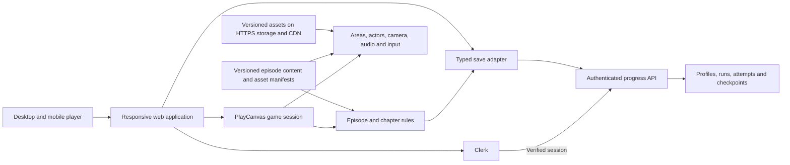

# David and Goliath · Project reset plan

11 November 2026. This is a proposal for owner review. It replaces the previous automatic progression through implementation task IDs. The source is the [scope supplied on 11 November](sources/game-scope-2026-11-11.md), with the owner's clarification that actual gameplay must work on desktop and mobile. The latest owner instruction fixes the completion target at five days. The planning assumption is 11–15 November inclusive. This supersedes the earlier twelve-week proposal.

## Product baseline

Deliver one complete David and Goliath episode in a responsive browser application. The player acts as David through exploration, conversations, preparation and the sling encounter. Cinematics establish the geography, develop the characters and show the outcome. The visual target is realistic cinematic 3D with an all-ages presentation.

The release includes registration, sign-in, profiles, a dashboard, six connected chapters, objectives, checkpoints, results, durable progress, replay and settings. The catalog and save contracts support future biblical episodes. Produce David and Goliath first.

Retain the prior decisions to portray David at about fifteen, preserve his existing appearance options, use Clerk, keep the biblical outcome fixed, and let a lethal attack by Goliath be the only defeat condition. The owner's 13 November brief authorises a countryside shepherd opening and short playable provisions journey before Elah. The subsequent correction requires Jesse personally to give the errand in his courtyard, with provisions collected there after the conversation. A distinct messenger arrives in the first field scene to say Jesse is calling; the keeper watches the flock. These remain inside Chapter 1 with the twelve ordered objectives preserved. The courtyard staging and three spear exchanges are identified as creative presentation.

The scope marks achievements required in section 7 and optional in section 12. It also conflicts with the earlier decision to defer rewards. Completion, chapter unlocking and factual performance summaries belong in the baseline. Achievement awards and scoring remain an explicit owner decision. The reference image's XP, stars and interface details are visual suggestions.

## Working together

**16 November control clarification:** the [automatic opening and control-design handover](../implementation/automatic-opening-and-control-design.md) removes the Tend trigger and records the owner's latest decision to retain Goliath's spear. Jump, Jump Shot and revised bindings are proposed in a separate browser preview; live battle remapping/airborne collision remain future integration work. This update does not establish final episode or release acceptance.

At the beginning of each milestone, the owner receives one short brief with the player experience, proposed scene layout, references, tasks, acceptance criteria and decisions. Implementation starts after that brief is approved.

At its review, the owner receives a playable link, desktop and mobile captures, test results, actual limitations and the next recommendation. The owner chooses approve, revise or defer. A passing engineering test establishes working behaviour. The owner accepts the story, appearance and play experience. Both are required before a milestone is accepted.

Use one backlog tied to the current milestone. Each item moves through proposed, approved, implemented, verified and owner-accepted. Record changes in a decision log. A new idea changes scope only after its impact on assets, effort and release is reviewed.

Codex owns implementation proposals, coding, automated verification and technical evidence. Segun owns creative and product decisions, budget, final content acceptance and access to providers and participants. Asset and service decisions need same-day turnaround for the five-day target. Additional artist availability is unconfirmed.

## What the current project gives us

| Area | Evidence | Treatment |
| --- | --- | --- |
| Browser runtime | PlayCanvas 2.24.0, TypeScript and Vite, with a WebGL 2 renderer. | Retain. Revisit a technology only if the representative production scene exposes a specific limitation. |
| Character and animation | David, appearance options, rigged Goliath, Blender source and sling, spear and fall clips. | Retain as working production candidates. Review proportions, surfaces, clothing, expressions and movement before accepting final art. |
| Gameplay | A courtyard with movement, collision and interaction, and an Elah fixture with aim, miss, dodge, lethal strike, retry, hit and retreat. | Retain tested behaviours and harnesses. Integrate them into the actual chapter journey. |
| World and narrative | Elah terrain, camps and supporting figures, the accepted Saul sample and M2's connected six-chapter outline. A richer Godot village and Jesse exchange exist separately. | Review the outline's pacing, then produce each PlayCanvas chapter to the accepted presentation reference. |
| Audio | Original synthesized effects and ambience; licensed generated David/Saul recordings, mouth animation and captions in the accepted sample. | Produce and review the remaining chapter dialogue, crowd sounds and music in M3. |
| Application and persistence | M4 implemented dedicated Clerk/Supabase development services, responsive product screens and owned cloud checkpoints. Real sign-in, full normal episode, isolation and Chrome-to-Edge resume passed on 17 November. [Handover](../implementation/m4-account-and-product-handover.md) | Owner product-journey review, then M5 compatibility/usability/performance and release checks. |
| Baseline | Local browser evidence exists. The workspace has an unborn master branch with no commits and untracked project files. | Preserve the files. Establish an approved versioned baseline before team production. Commit and push remain separate authorised actions. |

The existing tests establish a prototype's behaviour. They do not establish that the reference image's visual quality, a connected story or production mobile performance has been achieved. [SC-02 evidence](../implementation/playcanvas-sc02-encounter.md) · [PC-04 measurements](../implementation/playcanvas-pc04-foundation-review.md)

## Implementation order and review gates

These are acceptance gates within the five-day sprint. They are not separate multiweek phases.

| Milestone | Work in order | Demonstrable deliverable | Owner gate |
| --- | --- | --- | --- |
| M0 · Agree the game | Confirm scope, chapter treatment, visual references, device baseline, asset approach, audio approach and budget. Write scene cards and a short storyboard. | Game brief, chapter map, asset shortlist, architecture and acceptance checklist. | Approve what game we are building and how its quality will be judged. |
| M1 · Establish the production quality bar | Review existing David, Goliath, a camp section and a conversation shot. Agree which existing or immediately available licensed assets can deliver the intended look. Reuse the proven battle rules. | One short browser route and paired gameplay/conversation captures, with a mobile test path. | Approve the actual asset quality and mobile tier before expanding the scenes. |
| M2 · Make the story connect | Introduce versioned chapter definitions, objective events, inventory flags, cue ownership, checkpoint snapshots and area handoffs. Make a rough route through all six chapters with explicit temporary art labels. | A complete playable outline that finishes, reloads local development checkpoints and retries battle without losing preparation. | Approve pacing, objectives, story flow and control handoffs. |
| M3 · Produce the chapters | Finish chapter assets and scenes in story order. Add dialogue, acting, camera shots, sound and environmental activity. Review each chapter before integrating the next. | One consistent episode from opening to victory. | Accept each chapter against its scene card, then accept the complete episode. |
| M4 · Connect the product | Build the responsive landing, Clerk flows, profile, episode dashboard, chapter selection, settings and results. Implement owned progress writes and cross-session resume. Wire the episode through the same adapter used locally. | Website-to-game-to-dashboard journey with two-account isolation and cross-browser resume. | Approve the product journey and persistence behaviour. |
| M5 · Release candidate | Complete compatibility, usability, performance and save-failure checks. Conduct first-time player sessions, fix blockers and prepare staging and rollback. | A tested candidate, known-issues list and release recommendation. | Approve release from the actual candidate and evidence. |

**M4 engineering update, 17 November:** the authorised dedicated Clerk and free London Supabase development projects are connected. [Implementation and evidence](../implementation/m4-account-and-product-handover.md) record two real accounts, hosted owned saves, a fresh Edge sign-in resuming Chrome's checkpoint, sign-out protection, lost-response recovery and a full normal six-chapter run through replay. Final desktop/portrait/landscape touch checks passed on port 4206. M4 is ready for owner journey/persistence approval; M5 and production release remain open. No game deployment, commit or push.

**Progress, 11 November:** Segun accepted the David–Saul sample as the working cinematic reference and authorised continuing development. [M2's six-chapter local outline](../implementation/m2-connected-episode.md) is implemented with ordered objectives, actual preparation, checkpoint recovery, battle retry and replay. Its pacing/objective owner gate remains open. This is not acceptance of final episode art, mobile hardware performance or unconfigured online services. M3 chapter production follows review of the connected route.

**M3 update, 12 November:** Segun authorised and received [Chapter 1](../implementation/m3-chapter-01.md), [Chapter 2](../implementation/m3-chapter-02.md), [Chapter 3](../implementation/m3-chapter-03.md) and [Chapter 4](../implementation/m3-chapter-04.md) in the browser. His latest explicit instruction authorises [Chapter 5 — David and Goliath](../implementation/m3-chapter-05-brief.md): connect earned preparation to the voiced confrontation and player-controlled battle, with lethal defeat and Retry Battle. [Chapter 5 handover/evidence](../implementation/m3-chapter-05.md) record the actual handoff, responsive journeys, save recovery, fixture regression and measured performance limits. Permission to advance is not blanket final-art/release acceptance. Chapter 5 saves the actual hit and stops at its review gate before Chapter 6 production.

Define the save and content boundary in M0/M2 so story work can progress locally. Production service configuration can be prepared independently once ownership and budget are approved. The game runtime and scene acceptance remain the critical path.

**Controls revision, 12 November:** the owner reported that practice/duel actions were hard to understand and David lacked the desired direct control. [The scoped polish plan](../implementation/m3-controls-polish-brief.md) and [browser handover](../implementation/m3-controls-polish.md) address practice discovery, movement while throwing, direct mouse aim/click, simultaneous touch actions and a directional dodge. Chapter 6 remains on hold for review of these revised controls; engineering checks do not imply owner usability acceptance.

**Chapter 6 update, 12 November:** the owner's subsequent explicit instruction authorises [Victory](../implementation/m3-chapter-06-brief.md). [The implemented chapter and evidence](../implementation/m3-chapter-06.md) cover the curved/staggered retreat, foreground and crowd cheering, generated voices, original score, David/narration, actual Chapter 5 handoff and atomic episode completion/replay. The current candidate is ready for browser creative review; permission to advance does not imply final art, hardware performance or production-release acceptance. No M4 account/dashboard/backend work was performed in this step.

**Cinematic engagement update, 13 November:** the owner's supplied brief authorises the shepherd/errand/journey, Goliath entrance, David's commitment, three controlled spear evasions and clearer guidance across Chapters 1–6. [Implementation and evidence](../implementation/cinematic-engagement.md) record a fresh complete browser run, full silent video, repeated failed-dodge/retry checks, portrait/landscape touch input and measured performance. The final candidate is served on port 4191; port 4190 and its progress remain intact. The final audio-clock and empty-ammo safeguards have targeted verification in addition to the recorded complete journey. Creative acceptance, unaided-player usability, hardware performance and M4 services are not marked complete.

**Jesse correction, 13 November:** the owner requires David to meet Jesse and collect the provisions at Jesse's courtyard. [The correction](../implementation/jesse-courtyard-correction.md) replaces the earlier messenger/flock-site errand with a keeper handoff, playable courtyard approach, one voiced father–son exchange and a separate gated bench pickup. The corrected local review is port 4192; earlier builds and saves remain intact. This is an opening correction within M3, not authorisation to advance to M4.

**Opening clarification and sound, 13 November:** the owner requires the flock as the first scene and a separate arriving messenger to summon David. [The latest correction](../implementation/opening-messenger-audio.md) retains Jesse's personal errand and courtyard pickup, hardens Chapter 1 audio startup/recovery and records actual in-app output. Port 4193 starts at the beginning; no review walk ahead to the courtyard. The exact cause of the earlier in-app silence remains unconfirmed, rather than attributed to missing recordings without evidence.

### First implementation sequence after M0 approval

1. Select two environment references and one David/Goliath character sheet. Agree what must read clearly at gameplay and conversation distances.
2. Review a simple camp and overlook layout, with the start, walkable route, interaction, camera reveal and endpoint marked.
3. Approve the existing characters and a specific, immediately available environment/character asset set where replacements are necessary. Confirm licence, rig compatibility and mobile export budgets. Newly commissioned art requires a separate estimate against the five-day target.
4. Refine the existing controller and camera only where the scene needs it. Author the interaction and gameplay-to-cinematic-to-gameplay transition.
5. Render the approved material and lighting pass in PlayCanvas, then profile desktop and phones.
6. Review the actual browser slice together and record the acceptance or revision list.

This sequence gives art and gameplay an agreed target before expanding the cast or adding more environments.

## Six chapters as one journey

The following scene cards are a proposal. Their acceptance is part of M0. The biblical account is the screenplay foundation, while terrain compression, practice and optional discoveries are game adaptations.

| Chapter | Location, cast and player activity | Cinematics, assets and audio | Completion, checkpoint and next transition |
| --- | --- | --- | --- |
| 1 · The Valley of Elah | David on the camp approach and overlook, soldiers and opposing ranks in view. Learn movement and look, inspect one relevant landmark and understand the conflict. | Wide valley reveal, tents, ridge silhouettes, rocks and vegetation. Wind, camp sounds, a distant challenge and captions. | Complete the introduction and required discovery. Commit camp approach and open the route into the Israelite camp. Peaceful exploration remains active until the objective is met. |
| 2 · David Arrives | Enter the camp, meet the baggage keeper and brothers, deliver provisions and learn where the battle line is. | Delivery and greeting actions, provisions props, keeper and Eliab, camp activity and short dialogue shots. | Commit delivery once, preserve the empty bundle state and direct David to the challenge overlook. |
| 3 · The Challenge | Hear Goliath, see soldier reactions, speak with Eliab and express willingness to face him. | Goliath reveal, reactions, short exchanges and a clear faith beat. Dialogue and battle ambience. | Commit the required exchanges, unlock the audience with Saul and save at the next safe entry. |
| 4 · Preparation | Meet Saul, inspect and try his equipment, set it aside, visit the brook, gather five stones and practise a throw. | Saul and armour assets, fitting/refusal and gathering clips, brook and tutorial target, instructional feedback. | Armour refusal, sling readiness and stone gathering unlock battle.entry. Practice misses allow another attempt. Store preparations before the duel. |
| 5 · David and Goliath | Approach, exchange words, move, aim, release and evade. | Over-the-shoulder fight with authored anticipation, release, impact, reactions and fall. Keep the player's agency during combat. | A hit commits battle.aftermath once. A lethal Goliath strike offers Retry Battle at battle.entry with prior credit and equipment. A miss continues the same attempt. |
| 6 · Victory | See the defeat of the champion, the fleeing Philistines and the closing reaction. Review results, then replay or return. | Non-graphic conclusion, retreat, music and final dialogue or narration. Decide the treatment of verse 51 before recording. | Commit chapter and episode completion together, preserve history, and return to the dashboard. Replay creates a new run. |

Each final chapter card must also include its verse references, exact dialogue, shot timings, interaction targets, required clips, safe anchors, accepted events and test cases. Those details are approved before that chapter's production.

## Architecture to support that order

Keep PlayCanvas, TypeScript, Vite and Blender-to-GLB. The browser interface owns navigation, account views, readable controls and save feedback. PlayCanvas owns the rendered world, animation, camera and local combat. Typed story modules own objectives and chapter progression independently of presentation.

Recommend the existing Vite shell with Clerk's JavaScript components for the initial product. Choose an additional UI framework only if the approved screen design needs it. Clerk is already selected. Supabase/Postgres is the existing backend proposal and still needs project ownership, region, cost and integration approval. Its documented Clerk integration is a viable implementation path. [Clerk JavaScript integration](https://clerk.com/docs/js-frontend/getting-started/quickstart) · [Supabase Clerk integration](https://supabase.com/docs/guides/auth/third-party/clerk)

An episode definition supplies an episode ID, immutable content version, ordered chapters, objective rules, scene and asset IDs, camera cues, entry anchors and result rules. David and Goliath is the first catalog entry. A future episode adds its content and any new mechanics through these boundaries.

Persist profiles, settings, runs, chapter attempts, accepted objectives, checkpoint payloads and completion summaries. Authenticate every write, derive ownership from the session, validate the permitted transition and use revision checks and idempotency keys. Commit progress and the command receipt atomically. Keep per-frame input, animation and combat simulation local. Failure to save preserves the last confirmed checkpoint and offers a retry. [Existing data and save design](../implementation/playcanvas-production-blueprint.md#data-model)

Refactor the current movement-area coordinator as real chapter ownership is introduced. Extract camera, cue and session responsibilities through the existing entry points. Preserve the combat, input and regression behaviours while changing their orchestration.

**Final M3 integration, 12 November:** the owner authorised a fresh Chapters 1–6 integration pass. [The implementation plan](../implementation/m3-final-integration-brief.md) and [handover/evidence](../implementation/m3-final-integration.md) record all twelve objectives earned in one fresh normal run, confirmed checkpoint reloads, defeat/retry, actual Victory completion and replay history. The current local episode is on port 4190. Resume focus, normal chapter copy, the lightweight entry and sound preference continuity are corrected. Responsive input/layout and save recovery passed; the sustained laptop sample averaged 31.98 FPS, with the 60 FPS goal and the earlier chapter startup/download proposals unmet. Complete-episode owner review, real-device/Safari performance, unaided feedback and M4/M5 remain open. No production-release or final-art acceptance is inferred.

## Decisions in the order we need them

| ID | Decision and recommendation | Needed by |
| --- | --- | --- |
| D01 | **Confirmed.** Real desktop and mobile gameplay, responsive app, one complete first episode and a five-day completion target. The older desktop-only text and twelve-week proposal are superseded by the owner's latest instructions. | Planning baseline |
| D02 | Approve a reference set for realistic characters, terrain, animation and camera. Judge a real-time scene at two camera distances. | Before M1 art production |
| D03 | Choose the device and graphics floor. Recommend a scalable baseline with a higher desktop tier. Name the weakest supported Android and iPhone or approve tested equivalent devices. | M1 test brief |
| D04 | Approve the existing assets and any named, immediately available licensed replacements. Confirm the permitted spend. Custom character commissioning and a comprehensive realistic-art replacement need a separate feasibility decision. | Day 1 |
| D05 | Approve the chapter cards, target duration and exact opening. Recommend a brief Elah introduction that leads into David's arrival, with Jesse's errand as context. Confirm about-fifteen David and appearance choices in the realistic design. | M0 |
| D06 | Confirm combat assistance, tutorial and family-safe ending. Retain the lethal-strike-only failure rule and battle-entry retry. | M0 and M1 |
| D07 | Resolve achievements and scoring. Recommend completion and unlock records in the core release. Treat awards and scores as a deliberate scope choice because the source conflicts. | Before mission and dashboard schemas |
| D08 | **Generated character voices selected.** Approve the specific provider/voice licences, dialogue performance and music approach. Provider access and any spend remain dependencies. | Before chapter recording |
| D09 | Approve service ownership, hosting, retention and the account approach for an all-ages audience. Clerk remains the selected provider. | Before service provisioning |
| D10 | The owner sets five days. Confirm whether Day 1 is 11 November, then track the actual remaining work daily. Any missed acceptance gate requires an explicit owner decision on the delivery tradeoff. | Day 1 and daily review |

Only D01 and the retained prior decisions are treated as confirmed. Recommendations become decisions when the owner accepts them.

## Five-day delivery plan

Target completion is Day 5. Dates below assume Day 1 is 11 November 2026. The full release scope remains the acceptance baseline. This is a high-risk target from the current prototype, with unbuilt chapters and online services. It is not evidence that all requirements can be completed and polished in five days.

| Day | Implementation order | Demonstrable result and owner review |
| --- | --- | --- |
| 1 · 11 November | Settle the six chapter cards, approve existing/replacement art, the short dialogue script, voice source and crowd reactions. Define chapter events and safe checkpoints, and connect the rough chapter route. Begin development Clerk/database setup once access is available. | Review the complete route, visual asset choices and one short proposed conversation-and-reaction sequence. Approve the achievable art and audio bar for the sprint. |
| 2 · 12 November | Complete the camp, delivery, challenge, Saul and preparation interactions. Add voiced dialogue, mouth and body motion, listener reactions and captions using approved assets. Test mobile controls and chapter handoffs as each is integrated. | Play chapters 1–4, hear and see a character conversation, gather the stones and reach battle entry with actual preparations. |
| 3 · 13 November | Integrate the tested duel, retry, victory and retreat with the chapter state. Stage the crowd hush, Israelite cheering and Philistine flight with matching sound and motion. Add the approved dialogue/audio and environment presentation. Continue the account shell and progress adapter against the stable chapter contract. | Play from the opening to victory on desktop and mobile. Earlier preparation survives a lethal defeat and retry. Review the crowd's visible and audible response to the outcome. |
| 4 · 14 November | Finish Clerk flows, profiles, dashboard, chapter selection, settings, results and durable checkpoint writes. Exercise real account ownership, reload and cross-browser resume. | Complete the website-to-game-to-dashboard journey and return to confirmed progress. |
| 5 · 15 November | Resolve blockers, optimise measured mobile issues, run the full story, identity and save-recovery checks, conduct owner review and prepare the release candidate. | Review the actual build, test evidence and unresolved requirements. Accept release only against the agreed scope and gates. |

This schedule depends on immediate service access, prompt owner decisions and reuse of existing or readily available licensed assets. The exact illustrated reference quality remains an art acceptance requirement, not a guaranteed five-day result. A requirement that misses its gate stays recorded as incomplete. Any scope, quality or date tradeoff requires owner agreement.

## What “3D models” means

These are the shaped digital objects rendered in the game.

| Asset group | Examples and current position |
| --- | --- |
| Characters | David and Goliath already have GLB meshes and animation rigs. Saul, Eliab, the keeper and final soldiers need suitable character assets or approved adaptations of the existing base. |
| Clothing and equipment | Tunics, armour, helmets, sandals, sling, spear, shields and provisions. Some are built into the existing characters; new roles need reviewed wardrobe and props. |
| Environment and props | Tents, rocks, vegetation, terrain, camp equipment and brook details. The current Elah has basic versions that need a quality review against the desired scene. |

The mesh supplies shape, materials supply surface appearance, the rig supplies joints, and animation moves those joints. The existing character files are in apps/playcanvas/src/assets. The five-day recommendation is to reuse the working David and Goliath and approve a small compatible asset set for the remaining cast and environment.

## Characters speaking and crowds reacting

Spoken performance and coordinated reactions are part of the intended cinematic quality. They are explicit production work in the sprint.

| Moment | Visible performance | Sound and timing |
| --- | --- | --- |
| David speaks with Saul or Eliab | Mouth/jaw motion follows the line, with restrained head and hand gestures. The listener looks at David and reacts at the appropriate point. | Approved voice clips, speaker captions and an authored shot. A line completes once before the next begins. |
| Goliath challenges Israel | Goliath projects his challenge. Nearby soldiers turn, tense or step back; distant ranks react in groups. | Spatially placed voice, armour and distant camp sounds. The mix leaves the challenge intelligible. |
| David prepares and releases | Hands meet equipment, the sling follows the arm, and Goliath anticipates and reacts. | Footsteps, cloth, armour, sling and impact follow the animation and game events. |
| Israel recognises the victory | A short reaction beat leads to raised hands or shields and staggered cheers. | Layered crowd voices, individual shouts and music follow the confirmed outcome. |
| Philistines retreat | The shield-bearer and groups turn and flee in staggered motion. | Retreat calls, running and equipment sounds accompany the existing retreat action. |

Use reusable reaction clips with varied start times for distant groups. Give foreground speakers the detailed face and body work. This approach needs a measured crowd budget on mobile.

The owner selected generated character voices, with usage rights checked before use. The accepted [Saul sample](../implementation/m1-cinematic-sample.md) now supplies licensed generated David/Saul recordings, mouth controls, gestures, reactions and camera shots. [Voice provenance](../assets/saul-generated-voices.md) records the source and rights check. Its mouth animation is audio-driven rather than phoneme-aligned. The remaining chapter voices, detailed acting and cheering crowds are still production work; the M2 outline labels its temporary caption performances.

Review a 30–45 second conversation and reaction sample during the first day's creative review. Check audible lines, mouth timing, gaze, gestures, listener reactions and camera framing. In the integrated build, pause must hold audio and motion, retry must cancel prior clips, captions must remain readable when muted, and victory cheers must start once after the confirmed outcome.

The proposed first sample is [David's conversation with Saul](../implementation/m1-cinematic-review-brief.md), with a concrete shot sequence and draft dialogue for owner review.

## Acceptance and reporting

Set the precise hardware and network targets at D03. Working proposals are a sustained 30 FPS floor on the mobile baseline, a 60 FPS goal on the recommended desktop tier, measured cold-start and area-handoff limits, bounded peak memory, and quality presets. Start with no more than two foreground speaking actors, distant crowds using cheaper representations, baked or limited lighting, compressed textures and staged asset loading. Measure the largest scene before extending its budget.

An emulator can verify responsive layout and input. Real mobile playback is needed to judge memory, heat and GPU performance on the supported floor. Until such evidence exists, report mobile performance as unverified.

For every review, show the owner what changed, a playable route, the intended player actions, three representative captures, passed and failed checks, remaining issues, decisions and the next milestone. A first-time player must ultimately complete the website-to-story-to-results journey and return to confirmed progress. Exercise interrupted saves, duplicate writes, stale sessions, two-user isolation, chapter reload, miss, defeat, retry, victory and replay.

## Risks that can change the forecast

| Priority | Risk and early warning | Response and owner |
| --- | --- | --- |
| High | The desired art cannot be produced at the assumed speed or cost. The first character/scene review needs extensive revisions. | Set the art reference and source/commissioning budget before M1. Segun accepts the finish. Codex records the measured production cost and reforecasts. |
| High | The realistic scene exceeds phone memory or GPU capacity. The baseline device drops frames or reloads under load. | Reduce the measured asset, shading and shadow costs; use quality tiers and staged loading. Codex profiles. Segun approves the supported floor. |
| High | Chapters remain isolated fixtures. A new scene still relies on seeded preparation instead of player progress. | Require M2's connected outline and shared chapter contracts before full content production. Codex owns integration. |
| High | Saves or identity changes lose progress or expose another player's records. | Atomic commands, revision checks, verified ownership and recovery tests. Codex implements; Segun confirms provider ownership and release access. |
| Medium | Voice, music, art licences or participant access arrive late. | Track sources and owners during M0/M1 and schedule recordings from the approved script. Segun confirms budget and participation. |

Update, 11 November: the owner accepted the David–Saul cinematic sample and authorised development under this plan. [M2's connected episode and evidence](../implementation/m2-connected-episode.md) are ready for review of chapter order, objectives and recovery before M3. The remaining M0 service, hardware and final-asset decisions stay open.

[PlayCanvas feasibility assessment](../quality-review/playcanvas-scope-feasibility.md)
