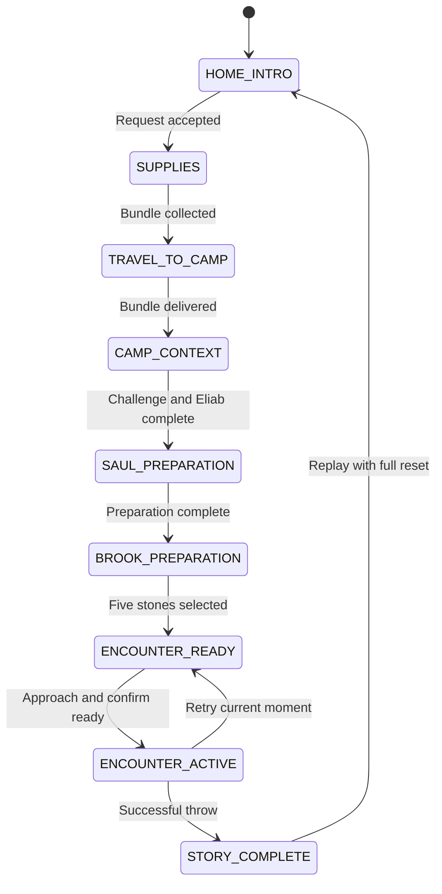

# David and Goliath story proposal

The [PlayCanvas episode design](david-and-goliath-episode-design.md) consolidates the current playable story for review, including the automatic Jesse exchange. The following draft records the earlier objective and dialogue work.

Version 1.1, updated 29 October 2026 for A02. **Product direction approved; detailed story map and dialogue remain drafts; nothing is implemented.** The owner approved the length, David role, fixed outcome, assisted sling aiming and non-graphic ending, plus the art/mobile/access/checkpoint choices in the [decision record](../implementation/a02-decision-record-2026-10-29.md). That scoped approval did not approve every objective, adaptation detail or line below.

Read with the [A02 delivery and decision proposal](../implementation/a02-story-and-delivery-proposal.md), [implementation plan](../implementation/implementation-plan.md) and [MVP acceptance criteria](../roadmap/mvp-scope-and-acceptance.md).

Direction update, 9 November: the owner requires Jesse's errand conversation to play as an animated script after one initial interaction, without repeated mandatory advances. The [quality plan's Q04 sequence](../implementation/animation-quality-improvement-plan.md#q04--stage-automatic-dialogue-and-object-handling) is the proposed replacement for the manual DL01–DL03 interaction below; its wording, shots and timing remain unapproved adaptation content. Preserve pause/read/replay/skip and a safe return to gameplay. Optional questions are not required to accept the errand. The older node table is retained as draft history, not the current implementation instruction.

## Recommended episode

Play as David in a short, continuous journey from his home setting to the battlefield. Aim for **10–15 minutes on a first playthrough**, excluding download time. The player walks, investigates, speaks, prepares and performs the decisive action. Short conversations provide context; the experience must not become a chain of cutscenes or dialogue boxes.

Use one fixed narrative outcome. Player choices change which explanation they hear and when they proceed, not the identity of the victor or the central events. No moral score, faith meter, alternate allegiance, branching ending or complex combat is proposed.

The proposed tone is accessible to general audiences, including families: respectful, tense and emotionally clear, with non-graphic combat presentation. This is an editorial recommendation, not an age-rating claim. Keep the story's faith context explicit without inventing a supernatural combat ability or turning faith into a game statistic.

## Biblical basis and adaptation boundaries

The narrative reference is **1 Samuel 17**, particularly verses 17–51. Jesse sends provisions; David encounters the challenge, speaks with Saul, sets aside unfamiliar armour, chooses five stones, and confronts Goliath. The account connects David's confidence with trust in God and describes the sling strike, Goliath's death and the opposing army's flight. References were checked against the [chapter text](https://www.biblegateway.com/passage/?search=1%20Samuel%2017&version=KJV) on 29 October. This reference check does not select a licensed production translation.

The following are **game adaptations**, not claims of exact historical reconstruction:

- A compact home courtyard, shortened walking route, simplified camp layout and nearby playable stream bank.
- Original short dialogue, contextual prompts, an abstract provisions bundle and a grouped stone-selection interaction.
- A brief armour movement demonstration, an assisted aiming interface and checkpoint retries.
- Condensed background armies and a short ending. No playable pursuit, beheading or display of a severed head.

The non-graphic ending compresses the account; it must not imply that the omitted events are absent from the source. The proposed final narration acknowledges Goliath's death without depicting the later violence. Do not show a recoverable fainting animation or add a survival ending. The owner/content reviewer must approve this treatment and the draft dialogue below. Avoid disputed numerical details, invented dates or claims of archaeological accuracy unless separately reviewed.

Production dialogue below is original adaptation text, **not a quotation from a Bible translation**. Any later verbatim scripture inclusion needs a named translation and appropriate rights/attribution review. The episode credits should identify the biblical reference and explain that conversations and geography have been adapted for play.

## Playable spaces and cast

| Space | Purpose | Minimum content |
|---|---|---|
| Village/home courtyard | Establish identity, teach controls and introduce the errand | David, Jesse, provisions object, simple doorway/path exit, readable landmarks |
| Connecting route and stream bank | Exploration, spatial continuity and preparation | One short path with a camp landmark; a stream branch revisited after the Saul conversation |
| Battlefield edge | Story context, preparation and dramatic encounter | Small camp supplies point, Eliab, Saul's open command shelter, overlook and bounded encounter ground |

The stream visit occurs **after** Saul's preparation scene. Reuse the route's side branch instead of adding a fourth large environment. Reveal the branch with a clear objective and landmark; do not create a long backtracking section. The battlefield remains visible before it becomes enterable, with an explanatory objective prompt at the boundary.

Five named characters are sufficient: player David and NPCs Jesse, Eliab, Saul and Goliath. Camp staff, a shield bearer and distant soldiers can use simple shared background representations where needed for context; no independent crowd simulation or extra quest-givers. Exact model selection, rig compatibility and rights are A05/C04 work, not completed assets.

## Objective and interaction sequence

These objective IDs are proposed stable content identifiers. Timing will be measured in the prototype rather than enforced with delays.

| Objective / state | Player action and purpose | Prerequisites | Success and feedback | Failure, revisit or recovery |
|---|---|---|---|---|
| O01 / HOME_INTRO | Move and look in the courtyard; approach Jesse and accept the errand | Fresh run | Required introductory dialogue finishes; `request_accepted` becomes true; objective changes to the provisions | Controls remain available in Help. Leaving the conversation offers Resume; no timer or penalty. |
| O02 / SUPPLIES | Inspect and take the prepared bundle | `request_accepted` | `supplies_collected` becomes true; visible bundle/object change and a route prompt | Repeated interaction reports that the bundle is already taken; no duplicate inventory or event. |
| O03 / TRAVEL_TO_CAMP | Follow the short route, find the camp supplies point and hand over the bundle | `supplies_collected` | `supplies_delivered` becomes true; camp context becomes available and objective names Eliab | Leaving the route returns to its safe spawn. The supplies point remains usable until delivery; no lost-item failure. |
| O04 / CAMP_CONTEXT | Reach the overlook, hear/read the challenge and speak with Eliab | `supplies_delivered` | Both `challenge_seen` and `eliab_conversation_complete` are true; a prompt leads to Saul | Either interaction may happen first. Required challenge text is replayable if missed; audio alone never gates progress. |
| O05 / SAUL_PREPARATION | Speak with Saul, try moving with unfamiliar armour, then remove it | O04 complete | Conversation and brief armour interaction complete; `saul_preparation_complete` becomes true; stream objective appears | Pause/retry removes temporary equipment and restores valid control. No branch permits permanent armour or an alternate combat system. |
| O06 / BROOK_PREPARATION | Find the stream, inspect a suitable group of stones and confirm taking five | `saul_preparation_complete` | One grouped interaction records `stones_ready`; pouch/hand feedback and Ready to approach objective appear | No five-object hunt, inventory screen or resource grind. Repeated gathering cannot increase an ammunition stat. |
| O07 / ENCOUNTER_READY then ENCOUNTER_ACTIVE | Approach, acknowledge the short exchange, position the aim and release the sling | `stones_ready`; encounter not already resolved | One valid successful throw sets `encounter_resolved`; reaction, sound and ending follow once | A miss offers retry at the encounter checkpoint. Pause and retry remain available; no developer repair or whole-episode restart is required. |
| O08 / STORY_COMPLETE | Read/watch the brief conclusion, optionally leave feedback, choose Replay | `encounter_resolved` | Clear completion screen and Replay action | Replay resets all objective/event/checkpoint flags and returns to HOME_INTRO. Feedback is optional and cannot block replay. |

Each main location includes a purposeful action: provisions handling, discovering the camp situation, preparation at the stream and the sling encounter. Additional scenery or optional conversation cannot replace these actions.

## Story state graph

Only the story manager accepts these transitions. Scene triggers, dialogue and animations request events; they cannot directly set arbitrary later states. Under the 9 November direction, required introductory dialogue completes through the sequencer's guarded normal-finish or explicit-skip path, rather than repeated node advances. Paused wall time cannot finish the conversation, and replay cannot duplicate progression. Optional questions, if retained in later dialogue, rejoin their parent conversation without advancing extra states.

Suggested in-session checkpoints are: home start, camp arrival, post-Saul preparation and encounter readiness. Each captures scene/spawn, objective, completed event flags and temporary equipment state together. Retry at the encounter restores the original readiness state; it is a game retry, not a claim that the biblical account contains repeated failed throws. Full restart clears every flag. Page reload begins a new run under the proposed no-durable-save baseline.

## Recommended encounter mechanic

**Assisted aim and release** provides a deliberate player action with a small implementation scope.

1. The player approaches the marked encounter boundary. Required preparation is checked before the short exchange starts.
2. The camera settles into a readable over-shoulder view. On touch, a thumb drag adjusts aim; on desktop, mouse motion adjusts aim.
3. The player centres a visible aiming guide on the target area. Generous aim assistance reduces precision demands; the indicator shows when a valid release is possible. No hidden timing window is required.
4. The player activates **Throw** by click/key or touch button. The release action, valid aim and unobstructed target determine success; it does not happen merely because a cutscene ends.
5. A successful throw triggers one outcome sequence. A miss gives immediate neutral feedback and **Retry this moment**; it restores the encounter checkpoint with preparation intact. Repeated attempts do not deplete a long-term inventory.

Goliath's stance, limited movement, scale, sound and camera framing create tension. No health bars, dodge rolls, sword combat, multiple-hit boss phases or damage economy are included. Keep player movement and pause predictable; prevent a premature throw from skipping dialogue or resolving the encounter twice. Aiming tolerance, camera distance and animation timing are prototype tuning values, not approved numeric thresholds.

| Alternative | Assessment |
|---|---|
| Assisted aim and release | Recommended: direct control, understandable feedback and a small set of test cases |
| Guided timing prompt | Possible fallback if mobile aiming proves unsuitable; requires owner agreement because it changes the central interaction |
| Full projectile/combat simulation | Defer: higher control, animation and testing workload without a demonstrated MVP need |

## Dialogue outline and draft core lines

All lines below are proposed original adaptation text. Keep conversations short and use clear speaker labels. Jesse's introductory exchange follows the automatic-play direction and Q04 replacement described above, with pause/read/replay available. Optional context choices in later conversations explain motivation; they do not create alternative endings. Full voice acting is not required for the first candidate.

| Node | Trigger / speaker | Draft line or choice | Result |
|---|---|---|---|
| DL01 | O01 / Jesse | “Before you leave, check the provisions. Take them to the camp and bring me news of your brothers.” | Offer DL02 |
| DL02 | David choice | “Where should I go?” or “I'm ready.” | First choice shows a route explanation, then returns here; ready accepts O01 |
| DL03 | Route explanation / Jesse | “Follow the path towards the army's camp. Leave the supplies there, then find your brothers.” | Return to DL02 |
| DL04 | O04 / Goliath, distant and subtitled | “Who among you will come forward and face me?” | Record challenge context; keep text replayable |
| DL05 | O04 / Eliab | “Why have you come so close to the fighting? You should be with the sheep.” | David response |
| DL06 | David | “Father sent me. Tell me what is happening here.” | Offer context or continue choice |
| DL07 | Context choice / Eliab | “The challenge has frightened the camp. Everyone is waiting for someone to answer.” | Return to continue choice; finish marks Eliab conversation complete |
| DL08 | O05 / Saul | “You have not trained as a soldier. This is a dangerous task.” | David response |
| DL09 | David | “I have faced danger while guarding the flock. I trust God to help me now.” | Allow brief armour preparation interaction |
| DL10 | After armour trial / David | “I cannot move naturally in this. I'll use what I know.” | Remove trial equipment and complete preparation |
| DL11 | O07 / Goliath | “They send a shepherd to face me?” | David response |
| DL12 | David | “Your weapons do not decide this. My trust is in the Lord.” | Offer Ready, Show controls or Not yet |
| DL13 | Encounter choice | Ready / Show controls / Not yet | Ready enters ACTIVE; controls returns to choice; not yet preserves READY |
| DL14 | After resolution / narrator | “David prevailed. Goliath was dead, and the opposing army fled.” | Brief non-graphic aftermath and completion |
| DL15 | Completion UI | Episode complete. Replay / Feedback | Replay performs full reset; feedback is optional |

DL14 is an adaptation summary, not a quotation. Further dialogue additions or changes to the narrative interpretation need content review. Interface instructions can be refined for usability without turning every wording adjustment into a new narrative decision.

## Story acceptance checks to implement later

| ID | Scenario | Expected result |
|---|---|---|
| ST01 | Try to depart before accepting the errand or collecting supplies | Helpful current-objective guidance; no accidental camp progression |
| ST02 | Repeat pickup/delivery and revisit finished conversations | No duplicated flags, objectives or items; optional context remains safe |
| ST03 | Complete camp interactions in either order | Saul becomes available only after both requirements are satisfied |
| ST04 | Interrupt armour preparation, retry or leave/re-enter | Correct equipment and camera state restored; no permanent control penalty |
| ST05 | Reach the stream or encounter boundary too early | Explanation of missing preparation; player remains able to return |
| ST06 | Miss the throw, pause during it or repeat Throw input | Valid retry/pause behaviour; exactly one resolution on success |
| ST07 | Play with audio muted or a small portrait viewport | All necessary information remains readable and actions remain reachable |
| ST08 | Complete, replay and attempt the same interactions again | Clean second run, including challenge, preparation and ending |

These are future test cases, not executed results. Approving this proposal establishes a content direction; it does not prove the episode is playable or close the browser feasibility gate.
